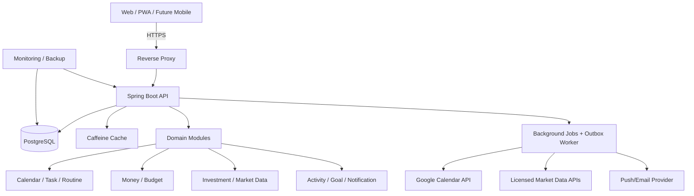
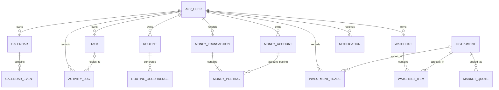

# MY TODAY — 개인 생활 운영체제 (Personal Life OS)

> **문서 종류:** 제품 요구사항 정의서(PRD) + 서비스 설계서 + 기술 아키텍처 + 데이터 모델/API 명세 + 개발 백로그  
> **문서 버전:** 1.0.0  
> **작성 기준일:** 2026-11-01 (Asia/Seoul)  
> **개발 저장소:** https://github.com/ssuukko/my-today  
> **문서 상태:** 구현을 위한 제안 명세. 확정된 구현이나 이미 개발된 기능을 의미하지 않음.  
> **핵심 전략:** 웹 우선 → 설치형 PWA → iOS/Android. 단일 백엔드, 모듈형 모놀리스, 개인 데이터 보호, 비용 최소화.

---

## 목차

1. [현재 상태와 제품 방향](#1-현재-상태와-제품-방향)
2. [비전·사용자·핵심 경험](#2-비전사용자핵심-경험)
3. [기능 범위와 단계 구분](#3-기능-범위와-단계-구분)
4. [정보 구조와 사용자 화면](#4-정보-구조와-사용자-화면)
5. [통합 홈 대시보드 상세](#5-통합-홈-대시보드-상세)
6. [일정·할 일·루틴](#6-일정할-일루틴)
7. [가계부·예산·자산](#7-가계부예산자산)
8. [주식·ETF·관심종목](#8-주식etf관심종목)
9. [실행 기록·목표·성장](#9-실행-기록목표성장)
10. [모듈 간 연결 및 자동화 규칙](#10-모듈-간-연결-및-자동화-규칙)
11. [검색·캡처·알림·인사이트](#11-검색캡처알림인사이트)
12. [사용성·접근성·디자인 시스템](#12-사용성접근성디자인-시스템)
13. [기술 스택과 설계 결정](#13-기술-스택과-설계-결정)
14. [백엔드 아키텍처와 이벤트 처리](#14-백엔드-아키텍처와-이벤트-처리)
15. [데이터 모델과 관계](#15-데이터-모델과-관계)
16. [핵심 SQL 마이그레이션 예시](#16-핵심-sql-마이그레이션-예시)
17. [REST API 설계](#17-rest-api-설계)
18. [외부 서비스 연동 및 제약](#18-외부-서비스-연동-및-제약)
19. [인증·보안·개인정보·백업](#19-인증보안개인정보백업)
20. [성능·관측·운영·비용](#20-성능관측운영비용)
21. [테스트와 수용 기준](#21-테스트와-수용-기준)
22. [단계별 개발 계획](#22-단계별-개발-계획)
23. [GitHub 프로젝트 구성과 개발 규칙](#23-github-프로젝트-구성과-개발-규칙)
24. [우선순위 백로그](#24-우선순위-백로그)
25. [출시 판단 기준과 미결 사항](#25-출시-판단-기준과-미결-사항)
26. [공식 참고 링크](#26-공식-참고-링크)

---

## 1. 현재 상태와 제품 방향

### 1.1 기존 프로젝트 확인

- 기존 `ssuukko/my-today` 저장소는 공개 `main` 브랜치이며, 확인 당시 루트에는 `README.md`만 존재한다.
- 기존 README의 **오늘 계획, 실제 활동, 성장 기록, 루틴**은 유지해야 할 핵심 제품 원칙이다.
- 실행 가능한 웹/서버/모바일 코드가 존재한다고 가정하지 않는다.
- 본 문서는 기존 README를 자동으로 변경하지 않는다. 구현 시 `docs/MASTER_SPEC.md`에 반영할 것을 권장한다.

### 1.2 문제 정의

일정은 캘린더, 할 일은 투두 앱, 지출은 가계부, 주가는 증권 앱, 목표는 노트 앱에서 각각 관리한다. 사용자는 정보를 반복 입력하고, 서로 다른 정보 간 연관성을 파악하기 어렵다. MY TODAY는 **사용자의 실제 행동을 기준으로 시간을 조직하고 돈과 목표까지 연결하는 단일 개인 대시보드**를 제공한다.

### 1.3 제품 철학

1. **오늘 중심:** 앱을 실행하면 가장 먼저 오늘을 이해하고 행동할 수 있어야 한다.
2. **연결 중심:** 하나의 행동이 일정·할 일·기록·예산 등 여러 맥락에서 재사용된다.
3. **입력 최소화:** 빠른 추가, 템플릿, 반복 규칙, 외부 데이터 연결을 제공한다.
4. **데이터 신뢰:** 예상/확정, 계획/실행, 잔액/수익률, 실시간/지연 시세를 반드시 구분한다.
5. **수정 가능:** 자동분류·추천·자동 연결 결과는 사용자가 언제든 수정·해제할 수 있다.
6. **프라이버시 우선:** 개인 데이터는 기본 비공개; 공개 범위·동의·삭제 기능을 기본 제공한다.
7. **단순한 첫 버전:** 마이크로서비스, AI 의존, 금융계좌 자동연동 등을 초기에 무리하게 구축하지 않는다.

### 1.4 핵심 지표(KPI) — 제품 가설

| 지표 | 정의 | 측정 방식 | 초기 목표/판단 |
|---|---|---|---|
| 오늘 준비율 | 하루를 시작하며 오늘 화면에 계획 1개 이상 있는 날 비율 | 사용자별 주간 집계 | 지속 사용자가 실제로 필요하다고 느끼는지 확인 |
| 실행 기록률 | 완료된 할 일 중 실행 기록과 연결된 비율 | 완료 과업/활동 관계 | 기록 강제 없이 증가 여부 관찰 |
| 빠른 입력 시간 | 할 일 또는 지출 1건을 저장하는 데 걸리는 시간 | UI 이벤트(내용 제외) | 일반적인 입력은 몇 번의 동작으로 완료 |
| 중복 데이터 비율 | 외부 동기화·가져오기로 생긴 중복 레코드 | 중복 키/감사 로그 | 중복 0건 유지 |
| 잔액 정합성 | 원장 합계와 계좌 잔액 일치 여부 | DB 정합성 테스트 | 불일치 0건 |
| 연동 복구율 | 토큰 만료·네트워크 장애 후 재연결 성공 | 백그라운드 작업 로그 | 복구 절차 제공 |
| 7일 재방문율 | 사용자가 자발적으로 재접속한 비율 | 익명화 집계 | 사용자 테스트 후 목표 수립 |

> 개인 단독 사용이라면 서비스 성장 KPI보다 **내가 실제로 반복해서 사용하는지, 잘못된 정보를 보여주지 않는지**가 더 중요하다. 숫자 목표는 출시 전 테스트를 통해 확정한다.

## 2. 비전·사용자·핵심 경험

### 2.1 목표 사용자

- **1차:** 나 혼자 쓰는 개인용 앱. 시간·지출·투자·성장을 한눈에 관리하려는 사용자.
- **2차:** 가족/지인 초대가 아닌, 각각 독립 데이터 공간을 가진 다중 개인 계정.
- **3차:** 공개 서비스 확장(구독형 포함) 검토. 이때 금융 시세 제공·외부 OAuth·개인정보 운영 규제가 별도 검증 대상.

### 2.2 대표 시나리오

**아침 08:00** — 오늘 일정 3건, 마감 할 일 2건, 오늘 쓸 수 있는 예산 24,000원, 관심 종목 가격 상태, 습관 2개를 하나의 홈에서 확인한다.

**점심 12:30** — `커피 5,000원`을 빠르게 입력하면 가계부와 하루 지출에 반영되고, 식비 예산이 재계산된다.

**오후 19:00** — `Java 공부 1시간` 할 일을 완료하면서 실제 45분을 기록한다. 오늘 실적·성장 통계는 실제 기록 45분만 사용한다.

**저녁 21:00** — 관심 종목 가격 알림을 확인하고, 이번 달 투자·현금 자산을 조회한다. 주식 시세가 오래되었으면 `지연` 또는 `업데이트 실패`를 표시한다.

**일요일** — 일정 이행률, 지출 추이, 가장 많이 투자한 시간, 루틴 달성 흐름을 주간 리뷰로 확인한다.

### 2.3 제품 경계: 서로 다른 개념을 구별한다

| 개념 | 의미 | 예시 |
|---|---|---|
| 일정(Event) | 특정 시각·기간에 잡힌 약속이나 블로킹 | 11/3 14:00 병원 |
| 할 일(Task) | 완료해야 할 행동 | 진료 예약 확인 |
| 루틴(Routine) | 정기적으로 반복할 행동의 정의 | 월~금 독서 20분 |
| 실제 활동(Activity) | 수행한 사실과 측정량 | 독서 18분 |
| 금융 거래(Transaction) | 자산에 영향을 준 실제 돈의 흐름 | 식비 12,000원 |
| 예상 현금흐름(Planned cash flow) | 아직 발생하지 않은 돈의 흐름 | 다음 달 월세 예정 |
| 주식 시세(Quote) | 특정 시점·제공처의 관측 가격 | AAPL USD 00.00, 조회시각 |
| 목표(Goal) | 기간 내 달성할 정량/정성 결과 | 한 달 공부 20시간 |

**금지 원칙:** 할 일 완료를 활동량으로 자동 중복 합산하지 않는다. 예정된 월급을 실제 잔액에 더하지 않는다. 현금 계좌와 주식 평가액을 자산 총액에 더할 때 동일 자금을 이중 집계하지 않는다.

## 3. 기능 범위와 단계 구분

| 기능 | M0: 사용 가능 MVP | M1: 통합성 완성 | M2: 확장/자동화 |
|---|---|---|---|
| 통합 홈 | 오늘 일정·할 일·지출·관심주식 카드 | 레이아웃 편집·주간 요약 | 상황별 스마트 카드 |
| 일정 | 수동 CRUD, 월/주/일 화면 | Google Calendar 읽기 동기화 | 양방향 연동·충돌 관리 |
| 할 일 | 생성·완료·마감·우선순위 | 하위 할 일·태그·반복 | 자연어 입력·자동 제안 |
| 루틴 | 요일 반복·수행 체크 | 목표량/예외일·통계 | 루틴 조정 제안 |
| 활동/성장 | 활동 생성·시간/횟수·통계 | 목표 연결·회고 | 개인 인사이트 |
| 가계부 | 수동 수입/지출/이체·카테고리 | 예산·고정비·월간 분석 | CSV 가져오기·자동 분류 |
| 자산 | 현금계좌별 잔액 | 대출·신용카드·순자산 | 금융회사 계좌 동기화(별도 검토) |
| 주식 | 관심종목·시세 표시 | 보유 수량·매수 기록·평가액 | 배당/분할·고급 차트 |
| 알림 | 마감/일정 로컬·서버 알림 | 예산/가격 임계치 | 스마트 묶음 알림 |
| 검색 | 통합 검색 | 고급 필터 | 의미 기반 검색 |
| 외부 연동 | 없음(수동 입력 우선) | 캘린더·가격 공급자 | 인증된 연동 확대 |
| AI | 없음 | 설명형 인사이트(규칙 기반 우선) | 선택적 생성형 AI |
| 플랫폼 | 반응형 웹 | PWA 설치·오프라인 조회 | iOS·Android 앱 |

### 3.1 명시적 비범위(초기 제외)

- 주식 주문/자동매매, 투자 조언·종목 매수 추천, 금융계좌의 자동 입출금.
- 카드사/은행 웹사이트 크롤링, SMS·이메일 무단 수집, 주민번호/금융 비밀번호 저장.
- 처음부터 실시간 틱 데이터를 모든 사용자에게 무제한 제공하는 기능.
- 공동 가계부, 가족 공유 권한, 기업 일정, 공개 소셜 피드, 복잡한 세금 신고 자동화.
- 완전한 오프라인 양방향 편집·충돌 병합. M0는 온라인 쓰기, 네트워크 연결에 따른 오류 메시지부터 구현.

## 4. 정보 구조와 사용자 화면

### 4.1 정보 아키텍처(IA)

```text
MY TODAY
├─ 홈 (/today)
│  ├─ 오늘 타임라인 / 지금 다음 일정
│  ├─ 할 일·루틴 / 빠른 입력
│  ├─ 오늘 지출·남은 예산 / 현금 현황
│  ├─ 관심 주식 / 가격 시점
│  └─ 오늘의 기록 / 마감 리뷰
├─ 캘린더 (/calendar)
│  ├─ 월/주/일 뷰
│  ├─ 내 일정 / 외부 캘린더
│  └─ 일정 생성·상세·반복 설정
├─ 할 일 (/tasks)
│  ├─ 오늘 / 예정 / 밀린 일 / 완료
│  └─ 프로젝트 / 태그 / 우선순위
├─ 루틴·성장 (/growth)
│  ├─ 오늘의 루틴 / 활동 타이머
│  ├─ 목표·성장 통계
│  └─ 일간·주간·월간 회고
├─ 가계부 (/money)
│  ├─ 거래내역 / 빠른 기록 / 이체
│  ├─ 계좌·카드 / 예산·고정비
│  └─ 월간 리포트 / 순자산
├─ 투자 (/invest)
│  ├─ 관심종목 / 시세·차트
│  ├─ 내 보유종목 / 거래내역
│  └─ 가격 알림·제공처 상태
├─ 통합 검색 (/search)
├─ 알림함 (/notifications)
└─ 설정 (/settings)
   ├─ 내 정보 / 시간대·통화
   ├─ 카테고리 / 위젯 / 알림
   ├─ 외부 계정 / 데이터 가져오기·내보내기
   └─ 보안 / 연결 해제 / 계정 삭제
```

### 4.2 데스크톱 홈 와이어프레임

```text
┌──────────────────────────────────────────────────────────────────────────────────┐
│ MY TODAY   오늘   캘린더   할 일   성장   가계부   투자   [⌘K 검색]  [알림]    │
├──────────────────────────────────────────────────────────────────────────────────┤
│ 2026.11.01 일요일                      안녕하세요       [+ 빠른 기록] [설정]    │
│ 오늘 한 줄: "오늘 꼭 해야 할 일 1개를 정하세요"                                │
├──────────────────────────────────────────────────────────────────────────────────┤
│ [오늘 일정 3개]  [할 일 2/6]  [오늘 지출 18,500원] [이번 달 예산 62% 사용]     │
├─────────────────────────────────────┬────────────────────────────────────────────┤
│ 시간표 / 일정                       │ 오늘의 할 일                              │
│ 09:00 ● 출근                         │ □ API 공부 / 마감 오늘                     │
│ 12:00 ● 점심                         │ ☑ 메일 확인                               │
│ 18:30 ● 운동                         │ □ 카드값 확인                              │
│ [+ 일정]                             │ [+ 할 일]                                  │
├─────────────────────────────────────┼────────────────────────────────────────────┤
│ 내 돈                                │ 관심 주식                                  │
│ 오늘 지출 / 월간 예산 / 최근 거래     │ 종목 / 현재·종가 / 등락 / 기준시각         │
│ [+ 수입] [+ 지출] [+ 이체]            │ [종목 추가] [새로고침]                    │
├─────────────────────────────────────┴────────────────────────────────────────────┤
│ 오늘의 루틴     독서 ○  운동 ✓  공부 ○   |  실제 활동 45분 / 목표 60분          │
│ 오늘의 회고 한 줄: [________________________________________________] [저장]  │
└──────────────────────────────────────────────────────────────────────────────────┘
```

**표시 값은 예시일 뿐 실제 사용자 데이터가 아니다.**

### 4.3 모바일 홈 와이어프레임

```text
┌────────────────────────────┐
│ MY TODAY        🔔     ⚙  │
│ 11월 1일, 일요일           │
│ [오늘] [주간] [월간]       │
├────────────────────────────┤
│ 다음 일정                 │
│ 14:00 진료               │
├────────────────────────────┤
│ 할 일 2 / 6    루틴 1 / 3 │
│ □ 자료정리    ✓ 물 마시기 │
├────────────────────────────┤
│ 오늘 지출    18,500원     │
│ 남은 월간 예산  xxx원     │
├────────────────────────────┤
│ 관심종목  업데이트 09:31  │
│ AAPL / 삼성전자 / ...     │
├────────────────────────────┤
│ [+] 무엇을 기록할까요?    │
├────────────────────────────┤
│ 홈   일정   할일   돈   더 │
└────────────────────────────┘
```

- 모바일 하단 탭은 최대 5개: `홈 / 일정 / 할 일 / 돈 / 더`. 투자·성장 메뉴는 `더`와 홈 카드에서 접근한다.
- 데스크톱은 좌측 사이드바 또는 상단 내비게이션. 가로 1024px 미만에서 단일 열/탭으로 전환한다.
- 빠른 입력은 언제나 최상단 또는 FAB로 접근한다.

### 4.4 화면 목록 및 최소 구성

| ID | 경로 | 반드시 있는 정보 | 기본 행동 |
|---|---|---|---|
| SCR-01 | `/today` | 오늘의 카드, 시간표, 주의 신호 | 빠른 입력 / 카드 상세 |
| SCR-02 | `/calendar` | 월/주/일 일정, 필터 | 일정 추가·수정·삭제 |
| SCR-03 | `/tasks` | 오늘/예정/밀린 할 일 | 완료·우선순위·마감 변경 |
| SCR-04 | `/growth` | 루틴 달성, 활동 합계, 목표 | 기록 시작·종료·수정 |
| SCR-05 | `/money` | 잔액, 거래내역, 예산 | 지출·수입·이체 입력 |
| SCR-06 | `/money/accounts` | 계좌별 잔액 및 유형 | 계좌 등록·조정 |
| SCR-07 | `/invest` | 관심종목, 마지막 가격 시점 | 종목 검색·추가·삭제 |
| SCR-08 | `/invest/assets` | 보유·원가·평가액·수익률 | 매매 기록 수동 입력 |
| SCR-09 | `/search` | 구분별 검색 결과 | 원본 화면으로 이동 |
| SCR-10 | `/settings` | 계정·통화·시간대·연동·데이터 | 설정 변경·내보내기 |

## 5. 통합 홈 대시보드 상세

### 5.1 홈 카드 및 데이터 계약

| 카드 | 데이터 원천 | 실시간성 요구 | 사용자에게 제공할 행동 |
|---|---|---|---|
| 오늘 일정 | `calendar_event` | 요청 직후 동기화된 서버 데이터 | 열기·수정·완료 아님 |
| 할 일 | `task` | 즉시 | 완료·연기·상세 |
| 루틴 | `routine_occurrence` | 즉시 | 수행·건너뛰기 |
| 오늘의 돈 | `money_entry` | 즉시 | 지출/수입/이체 |
| 이번 달 예산 | `budget` + 해당 거래 분류 | 즉시 | 예산 보기·수정 |
| 주식 | `market_quote` | 공급자 SLA에 따라 다름 | 보기·갱신·알림 |
| 성장 | `activity_log` | 즉시 | 기록 추가·수정 |
| 주간 인사이트 | 집계 테이블 또는 계산 | 비동기 집계 허용 | 상세·추천 해제 |

### 5.2 위젯 규칙

- 기본 홈은 개인 설정이 없어도 유용한 순서로 표출. 드래그 순서 변경은 M1.
- 모든 카드에는 **데이터 기준일/업데이트 시각**을 표시할 수 있어야 한다.
- 연동 실패 시 `정보 없음`을 `0원/0건`으로 둔갑시키지 않는다.
- 각 위젯은 개별 오류 격리: 시세 제공자가 다운되어도 할 일 화면은 정상 동작.
- 사용자가 위젯별 숨김/표시를 제어하고 설정은 서버에 저장한다.
- 홈 API는 집계 전용 BFF 성격. 하위 도메인 저장 명령은 홈 엔드포인트로 보내지 않는다.

### 5.3 오늘 상태 판정 예시

```text
긴급:  오늘 마감인데 완료하지 않은 할 일 2건
일정:  다음 약속까지 30분 (지금 시각 기준)
돈:    이번 달 식비 예산 90% 사용 (확정 거래만 기준)
투자:  관심 종목 목표 가격 조건 도달 (가격 시점 반드시 표시)
성장:  이번 주 공부 120/180분 달성 (실제 활동만)
```

알림 우선순위는 `사용자 지정 > 기한 임박 > 필요 행동 > 참고 정보`로 정하고, 단순한 주가 변화가 중요한 일정 알림을 밀어내지 않도록 한다.

## 6. 일정·할 일·루틴

### 6.1 일정(Calendar Event)

**필수 필드:** ID, 사용자 ID, 제목, 시작/종료, 하루 종일 여부, 시간대, 출처(내부/외부), 반복 규칙(선택), 생성·수정시각.

**선택 필드:** 메모, 장소, 태그, 색상, 미리 알림, 연결된 할 일, URL, 참석자(추후).

**검증 규칙:**

- 시간이 지정된 일정은 `end_at > start_at`; 날짜만 있는 일정은 시작일 포함·종료일 제외(`end_date_exclusive`)로 처리한다.
- 저장은 UTC `timestamptz`, 표시/반복은 사용자 지정 IANA 타임존(기본 `Asia/Seoul`)을 따른다.
- 해외 이동 시 일정의 **원래 시간대**와 표시 시간대를 혼동하지 않는다.
- 반복 일정은 RRULE 또는 반복 규칙과 개별 예외(`recurrence_exception`)를 분리한다.
- 반복 1회만 수정/삭제할 수 있어야 하며, 시리즈 전체 수정과 구분한다.
- 동일 외부 일정이 중복 생성되지 않도록 `(provider, external_calendar_id, external_event_id, recurrence_id)`로 식별한다.
- 외부에서 불러온 읽기 전용 일정은 수정 버튼을 제한하고 원본으로 이동 링크 제공.

**수용 조건:** 월/주/일 이동, 일정 생성·수정·삭제, 하루종일 일정, 시간 겹침 표시, 타임존 일관성, 반복 예외일 처리.

### 6.2 할 일(Task)

| 필드 | 예시 | 규칙 |
|---|---|---|
| title | 프로젝트 명세 작성 | 공백 불허, 길이 제한(예 1~200자) |
| status | TODO / IN_PROGRESS / DONE / CANCELED | 상태 변경 시각 기록 |
| due_at | 2026-11-02T08:00:00+09:00 | 날짜만 마감이면 별도 `due_date` 사용 |
| priority | P0, P1, P2, P3 | 정렬을 위해 숫자/열거값 고정 |
| estimated_minutes | 60 | 선택 항목. 실제 기록과 분리 |
| project_id | 개발 | 프로젝트 사용 안 해도 가능 |
| calendar_event_id | optional | 예약 시간과 업무 완료는 별개 |
| activity_category_id | 개발 | 실제 활동 연결용 |
| completed_at | timestamp | DONE일 때만 설정 |

**할 일 처리 규칙:**

1. 단건 완료 시 해당 작업만 DONE, 과거 기록 유지.
2. 반복 작업은 템플릿(`task_template`)과 날짜별 인스턴스(`task`)를 분리하고, 중복 생성 방지 키 적용.
3. 업무를 연기해도 과거 원래 마감 날짜의 사실이 사라지지 않도록 변경 기록 선택 저장.
4. 일일 체크리스트가 완료되었다고 실제 수행 시간이 자동으로 발생하지 않는다.
5. 완료 후 실제 활동을 입력할 수 있으며, 이때 동일 작업의 동일 활동이 중복 생성되지 않도록 연결 키를 사용한다.
6. 삭제는 기본 소프트 삭제; 오입력 복구 가능 기간을 둔다.

### 6.3 루틴(Routine)

- 반복 정의: 제목, 시간대, 요일 집합, 활성 시작/종료일, 목표량(`target_value`, `unit`), 활성 여부.
- 날짜별 발생: `routine_occurrence`에 `scheduled_date`, `target_snapshot`, `status`, `completed_at`, `skip_reason` 저장.
- 상태: `PENDING / DONE / SKIPPED / MISSED`; `SKIPPED`를 실패로 간주할지 여부는 통계 옵션으로 결정.
- 과거 루틴 목표량 보존: 루틴의 현재 목표가 20→40분으로 바뀌어도 과거 달성률은 당시 목표 20분 기준.
- 지나간 날짜의 자동 `MISSED` 전환은 사용자 현지 날짜가 완전히 지난 후 백그라운드 처리.
- 미리 인스턴스를 무제한 생성하지 않고, 요청된 범위에 대해 멱등 materialization 수행.

**루틴/할 일 차이:** 루틴은 재발생 정의, 할 일은 특정 실행 단위. 루틴 발생 항목을 할 일 카드에 함께 보여줄 수 있지만 **서로 다른 타입/키**로 구분한다.

### 6.4 시간 충돌 알림

- 같은 시간에 두 일정이 있으면 겹침 표시. 자동으로 일정 변경하지 않는다.
- 집중시간 블록과 일정이 겹치면 사용자에게만 충돌 경고.
- 일정을 수정했을 때 연결된 할 일 마감을 무조건 이동하지 않고 `연동 변경` 여부를 묻는다.

## 7. 가계부·예산·자산

### 7.1 금융 기능 목표

수입/지출 단순 메모가 아니라 **계좌별 잔액과 분류별 소비·월별 예산을 신뢰할 수 있는 개인 원장**으로 만든다.

### 7.2 계좌(Account)

종류: `CASH`, `CHECKING`, `SAVINGS`, `CREDIT_CARD_LIABILITY`, `LOAN_LIABILITY`, `BROKER_CASH`, `OTHER_ASSET`.

- 계좌에는 통화(`KRW`, `USD`, `JPY`), 이름, 최초 기준 잔액, 개설·활성 상태가 있다.
- `현재 잔액 = 시작 잔액 + 모든 확정 원장 증감의 합`; 애플리케이션은 단순 입력 금액을 수시로 덮어쓰지 않는다.
- 신용카드 부채는 자산이 아닌 부채. 사용 시 카드 부채 증가 및 비용 인식, 결제 시 부채 감소와 은행현금 감소.
- 증권계좌 현금과 주식 평가액은 자산 합산 시 구분한다.
- 대출 상환은 원금 감소와 이자 비용을 나누어 기록한다.

### 7.3 원장 기본 모델: 두 계정 간 이중 기록

재무 정합성을 위해 `money_transaction`(거래 헤더) + `money_posting`(계정별 변화)을 권장한다. 사용자가 입력하는 한 건의 거래는 내부적으로 2개 이상의 posting이 될 수 있다.

예) `식비 12,000원`을 A은행 계좌에서 지불:

```text
Transaction EXPENSE #101
  Posting: A은행 CASH             -12,000 KRW
  Posting: 식비 비용범주(가상계정) +12,000 KRW
```

예) A은행→B은행 50,000원 이체:

```text
Transaction TRANSFER #102
  Posting: A은행 CASH             -50,000 KRW
  Posting: B은행 CASH             +50,000 KRW
```

예) 10만 원 체크카드 사용을 6만 원 식비 + 4만 원 쇼핑으로 분할:

```text
Transaction EXPENSE #103
  Posting: A은행 CASH            -100,000 KRW
  Posting: 식비 비용범주           +60,000 KRW
  Posting: 쇼핑 비용범주           +40,000 KRW
```

**설계 주의:** 비용범주용 가상 계정은 현금성 자산에 포함하지 않는다. 같은 통화인 거래의 posting 합은 0이어야 한다. 외환거래는 환전 브리지와 적용 환율/수수료를 사용해 통화별 합계를 맞추며, 통화가 다른 posting 숫자를 직접 더해 0인지 검사하면 안 된다. 모든 posting은 서버 트랜잭션 내 생성·확정한다.

### 7.4 실제 결제 vs 예정 결제

- 실제/확정: `money_transaction.status=POSTED`, 잔액과 지출 통계에 포함.
- 임시/승인 대기: `PENDING`, 별도 잠정 표시; 기본 잔액 통계에 포함하지 않음.
- 예정 월세/구독: `recurring_bill` 또는 `planned_cashflow`, 미래 예측에만 사용.
- 수입 예정은 실제 입금이 확인되기 전까지 소득 합계·현금 잔액에 미반영.
- 같은 카드 내역을 수동 입력 후 CSV로 가져오면 자동 병합하지 말고 중복 후보를 비교·확정.

### 7.5 카드 지출과 결제일 처리

1. 신용카드 사용 시 비용 인식 + 카드 부채 증가(월간 소비 통계 포함).
2. 카드 결제일에 은행계좌 현금 감소 + 카드 부채 감소(소비 재인식 금지).
3. 카드대금 결제를 `이체/부채상환`으로 취급해야 월별 지출이 2번 잡히지 않는다.
4. 할부는 결제/청구 스케줄과 소비 발생시점을 분리하고, M1에서 구현한다.
5. 취소/환불은 기존 거래 수정으로 이력을 지우지 않고 원 거래 참조한 환입/반대 거래를 생성한다.

### 7.6 카테고리와 예산

- 카테고리: 식비/카페/교통/쇼핑/생활/통신/주거/구독/건강/교육/여행/기타 등; 사용자가 생성·이름 변경 가능.
- 예산 단위: 월별 또는 사용자 지정 기간; 카테고리별 한도, 통화, 이월 여부, 알림 임계치.
- 한도 300,000원, 확정 지출 180,000원이라면 사용률 60%, 잔여 120,000원.
- 환불은 관련 카테고리 지출에서 상쇄하고, 예산 음수/초과 상태는 명확히 표시.
- `예산 잔액`과 `은행계좌 잔액`은 다른 값임을 UI에서 분명하게 표기.
- 80%·100% 등 임계치 통과 알림은 최초 1회 또는 설정한 주기로 제한.

### 7.7 환율·다중 통화

- 기본 리포트 통화는 KRW. 거래의 원화 환산 값은 거래 당시 적용 FX 기준과 시점을 보존.
- 통화 금액 저장은 `NUMERIC(20, 6)` 등 정밀 숫자를 사용; Java `BigDecimal`, JavaScript 문자열 기반 십진수 라이브러리 사용.
- 현재 순자산을 합칠 때 필요한 환율은 `fx_rate`의 기준시각/제공처/유효성을 함께 표시.
- 환율 미확보 시 전체 평가액을 추정치로 표시하거나 해당 통화를 별도 제공; 무단으로 1:1 변환하지 않음.
- 투자 실현손익과 가계부 수입은 별도의 회계 정책이 있어야 한다. 매도대금 전체를 `수입`으로 표시하지 않는다.

### 7.8 가계부 리포트

- 일/주/월 소비, 카테고리 Top N, 전월 대비(기준 통화 일치), 고정/변동비, 예정 지출.
- 기본 통계에서 **계좌 간 이체·카드대금 납부·투자 원금 이동** 제외.
- 순자산 = 현금성 자산 + 평가 투자자산 + 기타 자산 − 카드 부채 − 대출 부채; 동일 자산 중복 제외.
- 빈 기간과 0원 기간을 구별한다. 수정/삭제/환불은 집계를 다시 계산한다.

## 8. 주식·ETF·관심종목

### 8.1 지원 목표

- 국내/미국 종목 관심목록 등록 및 검색.
- 현재/종가(공급자 지원 범위), 등락률·장 상태·데이터 기준시각 표시.
- 원하는 가격 도달 시 알림(설정/쿨다운 필요).
- 사용자의 수동 매수·매도·수량·수수료·세금 입력 후 보유현황과 수익률 계산.
- 주식에 관한 공시·배당·분할은 M2. 매매 실행 기능은 제외.

### 8.2 종목 정체성

종목명 문자열만 키로 사용하지 않는다. `instrument_id`(내부 PK), `market`(KRX/NASDAQ/NYSE 등), `symbol`, `currency`, `asset_type`, `provider_symbol`, 유효기간을 분리한다. 동일 티커가 여러 거래소에 존재할 수 있다.

### 8.3 시세 모델

```json
{
  "instrumentId": "7d3d...",
  "symbol": "AAPL",
  "exchange": "NASDAQ",
  "price": "245.31",
  "currency": "USD",
  "change": "1.25",
  "changePercent": "0.51",
  "provider": "example-provider",
  "marketState": "OPEN",
  "quoteType": "REALTIME",
  "quotedAt": "2026-10-30T14:01:00Z",
  "receivedAt": "2026-10-30T14:01:02Z",
  "stale": false
}
```

> 위 값은 **API 형식 설명을 위한 임의의 샘플**이며 2026-11-01 실제 시장 시세가 아니다.

- `quoteType`: `REALTIME / DELAYED / END_OF_DAY / MANUAL / UNKNOWN`.
- `quotedAt`: 제공처에서 관측한 시간, `receivedAt`: 내 서버 수신 시간. 서로 다르게 저장.
- 거래소 휴장일·장 종료 후 오래된 값은 잘못된 실시간 시세로 오인되지 않게 `마지막 종가`로 표시.
- 시세가 실패할 경우 직전 캐시 값을 사용하되 `오래된 가격` 배지·기준시각 표시; 처음부터 시세가 없다면 미제공.
- 차트는 일별 시세를 우선 사용하고 분봉은 공급자 권한/비용/저장 조건 확인 후 도입.

### 8.4 평가금액·손익 계산

- `평가금액(현지통화) = 보유수량 × 기준시각의 시세`.
- `평가손익(현지통화) = 평가금액 − 현재 남은 원가(매도/분할 반영)`.
- `평가수익률 = 평가손익 ÷ 남은 원가 × 100` (남은 원가 0이면 N/A).
- `실현손익 = 매도 순대금 − 매도 수량에 배분된 취득원가`.
- 평균매입법/선입선출 등 취득원가 정책은 설정 전 반드시 확정하고 과거 계산 정책을 보존.
- 수수료·세금·외화 환산손익은 별도 항목으로 추적. 단순 `현재가 - 매수가`를 원화 수익률로 오도하지 않는다.
- 배당, 액면분할, 합병, 입출고는 나중에 투자 원장을 확장해 반영. M1에서 지원하지 않는 경우 사용자에게 `추정` 표시.

### 8.5 가격 알림 규칙

- 조건: `ABOVE`, `BELOW`, `PERCENT_CHANGE`(선택).
- 가격 도달 판정은 **제공처 데이터가 새롭게 수신되었을 때만** 실행한다.
- 최초 충족 시 알림 1회, 이후 `COOLDOWN`과 `REARM`(가격이 다시 임계치 반대편으로 이동해야 재무장) 조건 사용.
- 장 마감/지연 데이터로 인한 중복 알림, 휴장 중 오탐 방지.
- 알림 메시지에는 `종목명, 조건, 관측 가격, 통화, 시각, 시세 유형` 포함.

### 8.6 법적·상업적 핵심 경계

**한국투자증권 KIS Open API**는 국내외 주식 REST/WebSocket 시세 기능을 제공하지만, 공식 안내상 개인 시세는 본인의 투자 목적 사용을 전제로 하며 **제3자 제공은 불가**하다. 그러므로 **나 혼자 쓰는 앱**과 **일반 사용자가 가입하는 공개 서비스**의 데이터 사용권은 구분해야 한다. 공개 서비스 전환 시 거래소/코스콤/제공처의 라이선스·재배포 허가를 별도로 확인해야 한다. 제휴형은 계약·자격 조건이 다르다. 또한 API 호출 제한은 공지에 따라 변한다. 상세 내용은 18장과 공식 링크 참조.

**중요:** 무료 API가 존재한다는 사실만으로 앱 화면에 재배포할 권리, 무제한 저장 권리, 상업적 제공 권리가 생기지 않는다.

## 9. 실행 기록·목표·성장

### 9.1 활동(Activity Log)

- 원천: 직접 기록 또는 할 일/루틴에서 `실제 활동 기록` 생성.
- 필드: 활동 분야, 수행 시점, 실제 지속시간(초/분), 수량, 단위, 기록 메모, 연결 task/routine/goal.
- 동일 단위끼리만 누적. `독서 20분 + 책 30페이지`를 50이라는 성장점수로 임의 환산하지 않는다.
- `duration_seconds`와 `quantity_value/quantity_unit`은 구분 저장.
- 계획 60분/실제 40분인 경우 완료 여부와 목표 달성률이 다를 수 있다.
- 업무 완료 자체와 활동 기록은 서로 다른 이벤트. UI는 연동 상태를 보여준다.

### 9.2 목표(Goal)

| 종류 | 예시 | 자동 집계 원천 |
|---|---|---|
| 시간 합계 | 11월 Java 공부 20시간 | `activity_log` 내 개발 카테고리 시간 |
| 실행 횟수 | 운동 12회 | 독립 activity ID/루틴 실적 |
| 숫자 누적 | 독서 300페이지 | 페이지 단위 활동 |
| 지출 상한 | 한 달 카페 80,000원 이하 | 가계부 확정 분류 거래 |
| 저축 목표 | 비상금 300만 원 | 선택한 계좌의 실제 잔액/입금 실적 |
| 체크리스트 | 포트폴리오 완성 | 연결된 마일스톤 상태 |

- 목표 집계 공식과 데이터 원천이 노출되어야 한다.
- 기록 수정 시 기계적으로 재집계.
- 수치 목표 외 정성 목표는 사용자 승인/메모로 완료 처리.
- 역방향 목표(지출 이하)와 정방향 목표(공부 이상)는 달성 기준이 다르다.

### 9.3 회고

- 하루: `잘한 일 / 놓친 일 / 내일 하나 바꿀 점` 선택 작성.
- 주간: 실제 사용시간 상위 분야, 할 일 완료율, 지출 추세, 루틴 수행률 자동 정리.
- 월간: 목표 진행률 및 예상 대비 실적, 지출·투자 평가액 추이(과도한 투자 성과 압박 없이).
- AI 없이 규칙 기반 설명으로 시작. 이후 생성형 AI 사용 시 개인 거래내역/민감정보 전송 동의를 별도 받는다.

## 10. 모듈 간 연결 및 자동화 규칙

### 10.1 연결은 '원본 1개 + 참조 여러 개'

| 트리거 | 원본 도메인 | 파생 액션 | 주의 |
|---|---|---|---|
| 할 일 완료 | Task | 오늘 카드 갱신, 선택 시 Activity 생성 제안 | 활동을 자동 중복 생성하지 않음 |
| 루틴 수행 완료 | Routine | 수행 실적 업데이트, 연결 Activity 1건 생성(옵트인) | `(occurrence_id, activity_type)` 멱등 |
| 지출 등록 | Money | 일일 지출·예산 카드 다시 계산 | 예산의 지출 기준은 확정거래 |
| 급여 입금 | Money | 수입 집계, 현금 잔액 갱신 | 예정 급여는 제외 |
| 카드 결제 | Money | 부채/현금 조정 | 비용 두 번 인식 금지 |
| 주가 수신 | Invest | 관심종목 카드 갱신, 가격 알림 판정 | 시세 신선도/권한 확인 |
| 일정 생성 | Calendar | 홈 시간표 반영 | 업무 자동 완료 금지 |
| 일간 마감 | Review | 오늘 회고 초안 집계 | 뒤늦은 수정 시 재집계 |

### 10.2 사용자 규칙 예시 (M2)

```yaml
id: notify-budget-80
when:
  domain: money
  event: budget.threshold_crossed
  condition:
    greater_or_equal: 80
then:
  - type: notify
    channel: in_app
    cooldown: P1D
```

이 YAML은 **아이디어/설정 명세**이며 실제 구현된 룰 엔진 문법이 아니다. 초기에는 코드 기반 `BudgetThresholdPolicy` 등으로 명확하게 구현하고, 임의 사용자 코드를 평가하는 런타임을 만들지 않는다.

### 10.3 통합 모델 원칙

- 모듈 간 직접 테이블 수정 금지. 하나의 모듈은 자신의 데이터를 변경하고 이벤트/서비스 인터페이스로 타 모듈과 통신.
- 모든 자동 행동의 트리거·결과·실패를 `automation_execution`으로 감사 가능하게 설계.
- API를 통한 저장은 원자적으로 처리, 외부 전송과 알림은 `outbox_event` 기반 비동기 처리.
- 실패 재시도는 중복 결과가 생기지 않게 소비자 처리 ID를 기록한다.
- AI가 작성한 행동 계획은 읽기/제안이 기본; 송금·매매·삭제 등 고위험 행위는 자동 실행 불가.

## 11. 검색·캡처·알림·인사이트

### 11.1 글로벌 빠른 입력

사용자가 상단 `+` 또는 `Ctrl/Cmd+K`로 아래 중 하나를 선택한다.

```text
할 일       "토요일까지 서버 배포"
일정       "11/5 15:00 치과"
지출       "점심 9,500원"
수입       "외주비 200,000원"
활동       "독서 25분"
관심종목   "AAPL"
```

- M0: 입력 유형을 사용자가 선택하고, 타입별 간단 폼으로 확정.
- M2: 자연어 파싱으로 필드 후보를 표시하되 **저장 전에 확인**.
- 입력 중 네트워크 오류 시 폼 내용 유지. 재시도는 중복 저장하지 않도록 `Idempotency-Key` 사용.

### 11.2 통합 검색

- 검색 범위: 일정/할 일/활동/거래 메모/종목/목표.
- 공통 검색 결과: `type, id, title, snippet, occurredAt, targetUrl`.
- 사용자별 격리 필수. 다른 계정 데이터 검색 불가.
- 금액·메모 등의 민감 데이터를 외부 검색 SaaS에 기본 전송하지 않는다.
- PostgreSQL Full Text Search 또는 `pg_trgm` 기반 검색 우선.

### 11.3 알림 구분

| 종류 | 채널 | 기본값 | 중복 방지 |
|---|---|---|---|
| 일정 시작 전 | 인앱 / PWA 푸시(지원 시) | 선택적 | 일정 ID + 알림시점 |
| 할 일 마감 | 인앱 | 켜짐 | 할 일 ID + 마감 상태 |
| 루틴 미완료 | 인앱 | 선택적 | 날짜 + 발생 ID |
| 예산 임계치 | 인앱 | 켜짐 | 예산 + 단계(80/100%) |
| 주가 조건 도달 | 인앱 | 사용자가 직접 설정 | 알림규칙 + 재무장 상태 |
| 월말 리뷰 | 인앱 | 선택적 | 사용자 + 기준 월 |

- 기본 조용한 시간(quiet hours)은 설정 가능; `Asia/Seoul` 기준으로 계산.
- 웹 푸시 권한 거부 시 인앱 알림만 사용.
- 동일한 이벤트를 이메일/푸시/인앱으로 보낼 때 사용자가 채널별 수신 여부 선택.
- 모바일 푸시는 OS/브라우저 정책과 설치 조건에 따라 지원 차이가 있다.

### 11.4 인사이트: 반드시 설명 가능한 규칙 기반부터

- `이번 주 카페 지출은 지난주보다 18% 많음` — 같은 분류·같은 통화·기간 비교 조건 충족 시만 표시.
- `목요일에 할 일이 자주 밀림` — 표본 수와 집계 기간을 함께 표시.
- `공부 시간을 저녁에 많이 확보함` — 실제 활동 시작시각과 수행분 기준.
- `월말 예상 현금 잔액` — `현재 확정 잔액 + 확정/예정 미래 현금흐름`의 시나리오임을 명시.
- `주가 변동이 크다` 등 투자 해석은 객관적 변화와 데이터 기준시각만 서술; 매수·매도 지시형 문구 금지.

## 12. 사용성·접근성·디자인 시스템

### 12.1 디자인 토큰(초기안)

| 토큰 | 라이트 | 다크 | 설명 |
|---|---|---|---|
| background | `#F7F9FC` | `#10151E` | 앱 배경 |
| surface | `#FFFFFF` | `#19212B` | 카드/모달 |
| text-primary | `#1A2433` | `#F0F3F8` | 주요 텍스트 |
| text-secondary | `#5A687B` | `#AAB5C3` | 설명 |
| brand | `#3665DB` | `#7E9DFF` | 주요 액션 |
| success | `#227A52` | `#5CCB95` | 정상/완료 |
| warning | `#9B6400` | `#F1BC55` | 주의 |
| error | `#C7394A` | `#FF7F8D` | 오류 |
| radius | `12px` | 동일 | 카드 |
| spacing | `4/8/12/16/24/32px` | 동일 | 일관된 간격 |

색상은 제안이며 접근성 대비 검사 후 조정한다. 주식 상승/하락은 색상만으로 표현하지 않고 `+/-`, 화살표, 숫자와 함께 표시한다. 한국/미국 주가 상승·하락 색상 문화가 다른 점을 고려해 색상 설정을 사용자화할 수 있다.

### 12.2 반응형 기준

- 360px 이상 모바일 세로 레이아웃, 768px 전후 태블릿, 1024px 이상 데스크톱 다중 열.
- 터치 타깃 최소 44×44 CSS px 권장; 키보드 탐색/포커스 표시.
- 명암 대비, 글자 확대, 화면 읽기 레이블, 입력 에러 설명, `prefers-reduced-motion` 대응.
- 개인정보가 포함된 홈 위젯은 미리보기/잠금화면/공유 스크린샷 노출 옵션 고려.
- 날짜와 금액 표기는 사용자 locale. 천단위 구분, 마이너스·통화 부호, 데이터 기준시각 명확히 표시.

### 12.3 UX 사용 원칙

1. 할 일 완료/지출 입력 등 자주 쓰는 행동은 **2~3단계 이내**.
2. 삭제·대량 가져오기 등 되돌리기 어려운 행동은 확인/되돌리기 지원.
3. 빈 화면은 `데이터 없음` + 첫 행동 CTA; 로딩/오류/비어 있음 상태 구분.
4. 계산 값은 클릭하면 **어떻게 계산했는지** 확인 가능.
5. 홈의 정보 밀도를 사용자가 선택: 간결 모드와 상세 모드.
6. 시작 시 시세/재무 연동 강제 금지. 할 일만 사용해도 정상 동작.

## 13. 기술 스택과 설계 결정

### 13.1 권장 기술 스택

| 영역 | 권장 | 선택 이유 | 대체/주의 |
|---|---|---|---|
| Backend | **Java 21 LTS + Spring Boot(개발 시점의 지원 중인 안정 버전 고정)** | Java 경험 활용, 테스트/인증/배치 생태계 | 처음부터 과도한 버전 추격 금지 |
| Web | **Vue 3 + TypeScript + Quasar** | 웹 UI와 PWA, 후속 Capacitor 기반 모바일 확장에 적합 | 실제 iOS/Android 네이티브 경험은 플랫폼별 검증 필요 |
| Mobile | **Quasar + Capacitor** (M2) | 화면/상태관리 코드 재사용 가능 | 푸시·생체인증·파일·백그라운드는 플랫폼 코드/플러그인 필요 |
| DB | **PostgreSQL 16+ 계열의 유지보수 지원 버전** | ACID, JSONB, 인덱스, 정밀 NUMERIC, 검색 | 선택 버전은 배포 환경 호환성 확인 |
| Persistence | Spring Data JPA + QueryDSL 또는 명시적 SQL(JdbcClient) | 일반 CRUD 간결·복잡한 리포트 SQL 제어 | 금융 원장은 명시적 쿼리/트랜잭션 우선 |
| Cache | Spring Cache + Caffeine (초기) | 별도 서버 불필요 | 다중 인스턴스로 확장 시 Redis 검토 |
| Migration | Flyway | DB 스키마 버전 관리 | 운영 데이터 수동 수정 금지 |
| API contract | Springdoc OpenAPI + 코드 생성(선택) | 웹-서버 타입 호환성 | Spring Boot 주 버전과 라이브러리 호환 확인 |
| Security | Spring Security, OAuth2/OIDC, 서버 세션 | 검증된 인증/인가, 웹 쿠키 보안 | 모바일 시 인증 모델 재평가 |
| Jobs | Spring Scheduler + DB 작업 잠금 | 단일 인스턴스에서 가볍게 시작 | 확장 시 ShedLock/작업 큐 검토 |
| Chart | Apache ECharts 또는 Chart.js | 자산·지출·시세 차트 | 사용한 라이브러리 라이선스 확인 |
| UI State | Pinia + Vue Query(TanStack Query Vue) | 캐시/서버 상태 분리 | 도메인 데이터 원본은 서버 |
| Test | JUnit 5, AssertJ, Testcontainers, Vitest, Playwright | DB 정합성·UI 회귀 검증 | 테스트 환경은 운영 데이터 사용 금지 |
| Deploy | Docker Compose + Nginx/Caddy + HTTPS | 개인 서버·소형 VPS에 적합 | 백업을 같은 서버에만 두지 말 것 |
| Monitoring | Actuator + Micrometer + 구조화 로그 | 장애 원인 파악 | 고비용 모니터링 SaaS 의무 아님 |
| CI/CD | GitHub Actions | 자동 테스트/빌드/배포 | 비밀 키를 GitHub Actions Secret으로 보호 |

**판단:** 사용자의 Java 백엔드 개발 역량과 웹 먼저 → 모바일 확장·비용 절약이라는 요구를 고려하면 **Spring Boot + Vue/Quasar + PostgreSQL의 모듈형 모놀리스**가 출발점으로 적합하다. React Native/Expo는 모바일 완성도가 최우선일 때 별도 ADR로 재평가한다.

### 13.2 왜 마이크로서비스가 아닌가?

- 핵심 도메인이 6~8개여도 개발/운영 인원이 적다면 마이크로서비스 배포·분산 트랜잭션·관측성 부담이 지나치게 크다.
- 도메인별 Java 패키지, 서비스 인터페이스, DB 스키마 접근 규칙을 갖춘 모듈형 모놀리스로 시작한다.
- 시세 업데이트만 병목이라면 **별도 워커 프로세스**로 먼저 분리한 뒤 필요할 때 서비스 분리를 검토한다.

### 13.3 권장 서버 구성



### 13.4 배포 환경

| 환경 | 목적 | 데이터 |
|---|---|---|
| Local | 개발자 PC에서 단위/통합 테스트 | 가짜 데이터 |
| Staging | 운영 유사성 검증, 외부 API 샌드박스 | 익명화/테스트 데이터 |
| Production | 실제 사용자 기록 | 개인 데이터 암호화·백업·접근 제한 |

- 로컬 Docker Compose는 웹/서버/DB를 한 번에 실행하는 개발 경험을 목표로 한다.
- 운영은 애플리케이션 DB 사용자가 `CREATEDB`, 슈퍼유저 권한을 갖지 않도록 한다.
- 도커 이미지 버전/체크섬 고정; 운영 이미지는 자동으로 최신 태그를 당겨 쓰지 않는다.

## 14. 백엔드 아키텍처와 이벤트 처리

### 14.1 모듈 구분

```text
com.mytoday
├── MyTodayApplication.java
├── common
│   ├── config / security / exception / audit / paging
│   └── time / money / idempotency / outbox
├── identity         # 사용자, 환경설정, 로그인, 연결 계정
├── calendar         # 일정, 반복, 외부 캘린더 동기화
├── task             # 할 일, 프로젝트, 템플릿
├── routine          # 루틴 정의와 날짜별 실적
├── activity         # 실제 활동, 측정, 목표, 회고
├── finance          # 계좌, 금융 원장, 예산, 예정흐름
├── investment       # 종목, 관심종목, 거래, 보유현황
├── market           # 가격 공급자 어댑터, 시세 캐시, 환율
├── dashboard        # 도메인별 읽기 전용 집계
├── notification     # 인앱/푸시 알림 정책
├── integration      # 외부 OAuth, CSV import/export
└── automation       # 도메인 이벤트 소비, 규칙/실행 이력
```

각 모듈 내 권장 구성:

```text
calendar/
  api/             CalendarController, DTO
  application/     CalendarCommandService, QueryService
  domain/          Event, RecurrenceRule, Events
  infrastructure/  JPA Repository, ExternalCalendarAdapter
```

- `Controller`는 입력 검증과 서비스 호출만 담당.
- `Application Service`는 유스케이스·트랜잭션 경계.
- `Domain`은 핵심 불변식과 정책, 외부 SDK 직접 의존 금지.
- `Infrastructure`는 DB/HTTP/스케줄러/외부 제공처와 통신.
- 통합 홈은 다른 모듈의 **공개된 QueryService**를 호출한다. 모듈 간 JPA 엔티티를 직접 수정하지 않는다.

### 14.2 핵심 명령 흐름

```mermaid
sequenceDiagram
    participant UI as Web
    participant API as Money API
    participant DB as PostgreSQL
    participant W as Outbox Worker
    participant N as Notification
    UI->>API: POST /money/transactions (Idempotency-Key)
    API->>DB: BEGIN; auth owner 확인
    API->>DB: 거래 + posting + 이벤트 저장
    API->>DB: CHECK 각 통화별 정합성; COMMIT
    API-->>UI: 201 Created (transactionId)
    W->>DB: 미처리 outbox 조회/잠금
    W->>N: 예산 임계치 판정 및 알림 발행
    W->>DB: 발송 이력/완료 기록
```

**재시도:** 앱이 타임아웃됐지만 서버 저장이 완료되었을 수 있다. 동일 사용자+요청키+요청 본문 해시로 이전 결과를 반환하고, 같은 키로 다른 내용을 제출하면 `409 CONFLICT` 처리한다.

### 14.3 내부 이벤트 목록

```text
calendar.event.created | calendar.event.updated | calendar.event.deleted
calendar.sync.failed | calendar.sync.recovered
task.created | task.completed | task.reopened | task.deleted
routine.occurrence.completed | routine.occurrence.skipped
activity.recorded | activity.corrected | goal.progress.changed
money.transaction.posted | money.transaction.reversed
money.budget.threshold_crossed | money.bill.due
market.quote.updated | investment.price_alert.triggered
notification.requested | notification.sent | notification.failed
```

이벤트에는 `eventId`, `eventType`, `aggregateId`, `userId`, `occurredAt`, `schemaVersion`, `payload`가 있어야 한다. 개인 민감 내용은 최소화하고 외부 이벤트 로그에 인증 토큰/거래 전체 내용 기록 금지.

### 14.4 이벤트 정합성 정책

- 단일 DB 트랜잭션 안에서 원본 변경 + outbox 기록.
- 워커는 **at-least-once** 배달을 전제로 설계. exactly-once 전송 보장이라는 표현은 사용하지 않는다.
- 이벤트 소비자마다 `(consumer_name, event_id)` 유니크 인덱스로 중복 실행 차단.
- 실패 시 지수 백오프와 최대 재시도 횟수, 초과 시 dead-letter 상태.
- 외부 알림 전송은 네트워크 실패 시 실제 발송 여부가 불명확할 수 있어 전달 키/제공자 멱등성을 점검한다.
- 투자 시세 갱신 이벤트는 가격이 변화하지 않은 경우 불필요한 집계/알림을 억제.

### 14.5 시간 처리 정책

- API 응답 시각은 ISO 8601 오프셋 또는 UTC `Z`로 표현.
- 일정의 지역 날짜(`LocalDate`)와 절대 시각(`Instant`)을 서로 다른 타입으로 보존.
- `TODAY` 집계 기준: 사용자가 설정한 IANA 타임존의 자정부터 다음 자정 직전까지.
- 서머타임(DST)이 있는 국가에서는 1일을 무조건 86,400초로 취급하면 안 된다.
- 날짜별 반복은 `LocalDate + ZoneId`로 계산하고, 존재하지 않는 시각/중복 시각 처리 방침을 명시.
- 서버 배치가 실행되지 않아도 조회 시 미생성 반복 인스턴스를 안전하게 생성할 수 있도록 한다.

## 15. 데이터 모델과 관계

### 15.1 식별 및 공통 컬럼 정책

- PK: UUID 또는 UUIDv7 기반 ID. PostgreSQL 버전의 생성 기능 지원을 확인하고 앱에서 생성하는 방식도 허용.
- 사용자 소유 데이터에는 `user_id NOT NULL`; 소유자를 API 요청 body에서 선택하도록 하지 않는다.
- 소프트 삭제 대상은 `deleted_at`; 확정된 원장 금융 거래는 원본을 계속 `POSTED`로 보존하고, `reversed_of`로 원본을 참조하는 **역거래를 새로 `POSTED`**로 기록한다. 화면의 취소 여부는 역거래 존재로 파생 계산한다.
- `created_at`, `updated_at`, `version`(낙관적 잠금)을 변경 가능한 레코드에 적용.
- 사용자 삭제 시 도메인 데이터 삭제/익명화 및 백업 보존 정책을 별도로 정의.
- 금액 = 통화 + BigDecimal. 수익률/퍼센트 = 정밀 decimal. 비밀 토큰 = 암호화 컬럼.

### 15.2 필수 테이블 목록

| 테이블 | 중요한 필드 | PK/유니크·인덱스 포인트 |
|---|---|---|
| `app_user` | id, email, display_name, timezone, base_currency, status | `email_normalized` 유니크 |
| `user_setting` | user_id, dashboard_layout, quiet_hours, locale | user_id 유니크 |
| `auth_identity` | user_id, provider, provider_subject | `(provider, provider_subject)` 유니크 |
| `external_connection` | user_id, provider, encrypted_tokens, scopes, expires_at, status | 제공자별 연결 키 |
| `calendar` | user_id, name, color, source, external_id | `(user_id,source,external_id)` 조건 유니크 |
| `calendar_event` | user_id, calendar_id, start/end, all_day, timezone, rrule, external_id | `(user_id,start_at)` + 외부키 |
| `recurrence_exception` | master_id, recurrence_original_at, override_id, cancelled | `(master_id,recurrence_original_at)` |
| `task_project` | user_id, title, archived | `(user_id,title)` 선택 유니크 |
| `task` | user_id, title, status, due_date/at, priority, completed_at, version | `(user_id,status,due_at)` |
| `task_template` | user_id, rrule, title, start_date, enabled | 활성 템플릿 인덱스 |
| `routine` | user_id, rrule/weekdays, category_id, target_value/unit | 활성 목록 인덱스 |
| `routine_occurrence` | user_id, routine_id, date, target_snapshot, status | `(routine_id,date)` 유니크 |
| `activity_category` | user_id, name, unit | 사용자별 분류명 |
| `activity_log` | user_id, category_id, task_id, duration, quantity, started_at | `(user_id,started_at)` |
| `goal` | user_id, measurement_type, target, unit, period, source_policy | `(user_id,status,end_date)` |
| `daily_review` | user_id, local_date, good, improve, tomorrow | `(user_id,local_date)` 유니크 |
| `money_account` | user_id, name, type, currency, opening_balance, active | `(user_id,type)` |
| `money_category` | user_id, name, category_type, parent_id | 사용자별 카테고리 인덱스 |
| `money_transaction` | user_id, type, occurred_at, status, memo, external_ref, reversed_of | `(user_id,occurred_at)`, idempotency |
| `money_posting` | transaction_id, account_id, category_id, signed_amount, currency | `(transaction_id,account_id)` |
| `budget` | user_id, category_id, period_start/end, currency, limit_amount | `(user_id,category_id,period_start,period_end)` |
| `planned_cashflow` | user_id, account_id, category_id, amount, due_date, status, recurrence | `(user_id,due_date)` |
| `fx_rate` | base_currency, quote_currency, rate, quoted_at, provider | `(base,quote,quoted_at,provider)` |
| `instrument` | market, symbol, currency, name, asset_type | `(market,symbol)` 식별 |
| `market_quote` | instrument_id, provider, quoted_at, received_at, quote_type, price | `(instrument_id,provider,quoted_at)` |
| `watchlist` | user_id, name | `(user_id,name)` |
| `watchlist_item` | watchlist_id, instrument_id, sort_order | `(watchlist_id,instrument_id)` |
| `investment_account` | user_id, name, base_currency, money_account_id | 사용자별 계좌 |
| `investment_trade` | user_id, account_id, instrument_id, side, quantity, price, fees, taxes, traded_at | `(user_id,traded_at)` |
| `investment_lot` | account_id, instrument_id, remaining_qty, remaining_cost | 취득원가 정책 적용 |
| `price_alert` | user_id, instrument_id, condition, threshold, state, cooldown_until | `(user_id,enabled)` |
| `notification` | user_id, event_type, payload, status, read_at | `(user_id,created_at)` |
| `notification_delivery` | notification_id, channel, provider_ref, status, attempt_count | `(notification_id,channel)` |
| `idempotency_record` | user_id, scope, request_key, request_hash, response_status/body, expires_at | `(user_id,scope,request_key)` 유니크 |
| `outbox_event` | id, type, aggregate_id, user_id, payload, status, attempts | `(status,next_attempt_at)` |
| `processed_event` | consumer_name, event_id, processed_at | `(consumer_name,event_id)` 유니크 |
| `audit_log` | user_id, entity_type, entity_id, operation, actor, at, metadata | `(user_id,at)` |

> 구현 시 M0에 해당하는 테이블부터 작성한다. 모든 테이블을 첫 배포에 생성할 필요는 없다. 각 테이블의 구체 컬럼 타입은 Flyway 마이그레이션과 ORM 모델을 **단일 기준**으로 유지한다.

### 15.3 주요 관계(축약 ERD)



### 15.4 테이블 간 권한/정합성

- `money_posting.account_id`가 가리키는 계좌의 사용자와 거래의 사용자가 같아야 함.
- `watchlist_item.instrument_id`는 공통 종목 마스터를 참조해도 소유한 `watchlist`는 반드시 사용자별 격리.
- `activity_log.task_id` 참조는 같은 사용자 간 연결만 허용.
- 읽기 조회 시도 단독 레코드 ID만으로 접근하지 않고 `WHERE id=? AND user_id=?` 조건을 기본으로 한다.
- 권한 검사 보완책으로 PostgreSQL RLS 도입을 검토하되, **RLS만 믿고 서비스 권한검사를 생략하지 않는다**.

## 16. 핵심 SQL 마이그레이션 예시

아래는 **PostgreSQL 기준 설계 예시**로, 모든 도메인 테이블을 한 번에 생성하는 완성 마이그레이션이 아니다. PK 생성·인덱스·검증 트리거·FK 삭제 정책은 실제 구현 시 확정한다.

```sql
-- V1__identity_and_tasks.sql
CREATE TABLE app_user (
  id UUID PRIMARY KEY,
  email_normalized VARCHAR(320) NOT NULL UNIQUE,
  display_name VARCHAR(80) NOT NULL,
  timezone VARCHAR(80) NOT NULL DEFAULT 'Asia/Seoul',
  base_currency CHAR(3) NOT NULL DEFAULT 'KRW',
  status VARCHAR(20) NOT NULL DEFAULT 'ACTIVE',
  created_at TIMESTAMPTZ NOT NULL DEFAULT NOW(),
  updated_at TIMESTAMPTZ NOT NULL DEFAULT NOW()
);

CREATE TABLE task (
  id UUID PRIMARY KEY,
  user_id UUID NOT NULL REFERENCES app_user(id),
  title VARCHAR(200) NOT NULL,
  status VARCHAR(20) NOT NULL DEFAULT 'TODO',
  priority VARCHAR(2) NOT NULL DEFAULT 'P2',
  due_date DATE,
  due_at TIMESTAMPTZ,
  completed_at TIMESTAMPTZ,
  estimated_minutes INTEGER CHECK (estimated_minutes IS NULL OR estimated_minutes >= 0),
  version BIGINT NOT NULL DEFAULT 0,
  created_at TIMESTAMPTZ NOT NULL DEFAULT NOW(),
  updated_at TIMESTAMPTZ NOT NULL DEFAULT NOW(),
  deleted_at TIMESTAMPTZ,
  CONSTRAINT ck_task_status CHECK (status IN ('TODO','IN_PROGRESS','DONE','CANCELED')),
  CONSTRAINT ck_task_priority CHECK (priority IN ('P0','P1','P2','P3')),
  CONSTRAINT ck_task_title CHECK (LENGTH(TRIM(title)) > 0),
  CONSTRAINT ck_task_done CHECK (
    (status = 'DONE' AND completed_at IS NOT NULL)
    OR (status <> 'DONE' AND completed_at IS NULL)
  )
);
CREATE INDEX idx_task_user_status_due ON task(user_id, status, due_date)
  WHERE deleted_at IS NULL;
```

```sql
-- V2__finance_ledger.sql
CREATE TABLE money_account (
  id UUID PRIMARY KEY,
  user_id UUID NOT NULL REFERENCES app_user(id),
  name VARCHAR(100) NOT NULL,
  kind VARCHAR(30) NOT NULL,
  currency CHAR(3) NOT NULL,
  opening_balance NUMERIC(20,6) NOT NULL DEFAULT 0,
  is_system BOOLEAN NOT NULL DEFAULT FALSE,
  created_at TIMESTAMPTZ NOT NULL DEFAULT NOW(),
  CONSTRAINT ck_money_account_kind CHECK (
    kind IN ('ASSET','LIABILITY','EXPENSE','INCOME','EQUITY')
  ),
  UNIQUE (id, user_id)
);

CREATE TABLE money_transaction (
  id UUID PRIMARY KEY,
  user_id UUID NOT NULL REFERENCES app_user(id),
  tx_type VARCHAR(30) NOT NULL,
  status VARCHAR(20) NOT NULL DEFAULT 'POSTED',
  occurred_at TIMESTAMPTZ NOT NULL,
  memo VARCHAR(500),
  reversed_of UUID,
  created_at TIMESTAMPTZ NOT NULL DEFAULT NOW(),
  UNIQUE (id, user_id),
  FOREIGN KEY (reversed_of, user_id) REFERENCES money_transaction(id, user_id),
  CONSTRAINT ck_money_tx_status CHECK (status IN ('PENDING','POSTED'))
);
CREATE UNIQUE INDEX ux_money_tx_reversal ON money_transaction(reversed_of)
  WHERE reversed_of IS NOT NULL;

CREATE TABLE money_posting (
  id UUID PRIMARY KEY,
  user_id UUID NOT NULL,
  transaction_id UUID NOT NULL,
  account_id UUID NOT NULL,
  signed_amount NUMERIC(20,6) NOT NULL,
  currency CHAR(3) NOT NULL,
  category_id UUID,
  created_at TIMESTAMPTZ NOT NULL DEFAULT NOW(),
  FOREIGN KEY (transaction_id, user_id)
    REFERENCES money_transaction(id, user_id),
  FOREIGN KEY (account_id, user_id)
    REFERENCES money_account(id, user_id),
  CONSTRAINT ck_posting_nonzero CHECK (signed_amount <> 0)
);
CREATE INDEX idx_money_tx_user_time ON money_transaction(user_id, occurred_at DESC);
CREATE INDEX idx_money_posting_account ON money_posting(user_id, account_id);

-- 중요: posting 합계 0 여부는 INSERT 1행마다가 아닌
-- 모든 posting 저장 후 커밋 이전에 검증해야 함.
-- 초안에서는 서비스 트랜잭션에서 통화별 합을 검증하고,
-- 운영 단계에서는 DEFERRABLE constraint trigger 등 DB 레벨 보호 추가.
-- 'opening_balance'는 최초 기준값이며 이전 데이터를 중복 입력하지 말 것.
```

### 16.1 원장 계산 예제

확정된 거래(`status='POSTED'`)만 합산해야 하므로, **아래처럼 확정 거래를 내부 JOIN에서 먼저 거른 뒤 외부 JOIN**을 사용한다.

```sql
SELECT a.id,
       a.opening_balance + COALESCE(x.posted_delta, 0) AS ledger_balance
FROM money_account a
LEFT JOIN (
  SELECT p.account_id, SUM(p.signed_amount) AS posted_delta
  FROM money_posting p
  JOIN money_transaction t ON t.id = p.transaction_id
  WHERE t.status = 'POSTED'
  GROUP BY p.account_id
) x ON x.account_id = a.id
WHERE a.id = :account_id AND a.user_id = :user_id;
```

`opening_balance`를 가져올 때도 반드시 사용자 소유 계좌인지 먼저 확인하며, 통화가 다른 거래는 같은 계좌에 무분별하게 기록하지 못하게 한다. **부채 계좌는 signed balance를 음수로 관리**한다. 최초 부채는 음수, `현재 순자산 = 자산 잔액의 합 + 음수 부채 잔액의 합`.

### 16.2 DB 제약 테스트 (필수)

- posting이 1개뿐인 거래는 확정할 수 없음.
- 같은 통화에 대한 각 posting 합이 0이 아니면 확정 거절.
- 다른 사용자 소유 계좌와 거래 연결 불가(FK 또는 서비스 검증).
- `POSTED` 거래는 임의 수정/삭제/상태변경 금지; 정정은 역거래+신규 거래. 역거래 생성 후 원거래도 합계에 남아 있어야 결과가 정확히 상쇄된다.
- 동일 멱등키로 재전송 시 잔액이 2번 증가하지 않음.
- 임시/대기 거래가 계좌 `ledger_balance`에 포함되지 않음.
- 카드대금 결제 시 비용 집계는 늘지 않음.

## 17. REST API 설계

### 17.1 공통 규약

- Base path: `/api/v1`.
- JSON, UTF-8, 날짜/시간 ISO 8601, 금액/가격/수량은 오차 회피를 위해 **문자열 십진수** 권장.
- 목록 API: `cursor`, `size`, `sort`; 반복 조회 결과 안정 정렬.
- 페이지 크기 상한(예: 100건), 필터·정렬 허용 필드 whitelist.
- 모든 개인용 리소스는 인증된 사용자 ID로 조회; 임의 `userId` body 입력 신뢰하지 않음.
- 생성에는 `Idempotency-Key` 지원(특히 금융 거래/외부 동기화).
- 수정은 `If-Match`/버전 비교 또는 요청 `version`으로 동시 편집 충돌 처리.
- 응답에는 서버 `requestId`를 남겨 로그 추적.

### 17.2 핵심 API 라우트

| HTTP | 경로 | 기능 | 단계 |
|---|---|---|---|
| GET | `/users/me` | 로그인 정보/시간대/통화 | M0 |
| PATCH | `/users/me/settings` | 사용자 설정 | M0 |
| GET | `/dashboard/today?date=YYYY-MM-DD` | 오늘 종합 홈 | M0 |
| GET | `/dashboard/summary?period=week` | 주간 요약 | M1 |
| GET | `/calendar/events?from=&to=` | 날짜 범위 일정 | M0 |
| POST | `/calendar/events` | 일정 생성 | M0 |
| PATCH | `/calendar/events/{id}` | 일정 수정 | M0 |
| DELETE | `/calendar/events/{id}` | 일정 삭제/취소 | M0 |
| POST | `/calendar/connections/google` | Google 연결 시작(별도 OAuth 흐름) | M1 |
| POST | `/calendar/connections/{id}/sync` | 수동 동기화 요청 | M1 |
| GET | `/tasks?status=&date=&cursor=` | 할 일 목록 | M0 |
| POST | `/tasks` | 할 일 추가 | M0 |
| PATCH | `/tasks/{id}` | 할 일 수정 | M0 |
| POST | `/tasks/{id}/complete` | 할 일 완료 | M0 |
| POST | `/tasks/{id}/reopen` | 완료 취소 | M0 |
| GET | `/routines?active=true` | 루틴 정의 조회 | M0 |
| POST | `/routines` | 루틴 정의 생성 | M0 |
| GET | `/routines/occurrences?date=` | 날짜별 루틴 발생 | M0 |
| POST | `/routines/occurrences/{id}/complete` | 루틴 달성 | M0 |
| POST | `/activities` | 실제 활동 기록 | M0 |
| GET | `/activities/summary?from=&to=&unit=` | 활동 집계 | M0 |
| GET | `/goals` | 목표 목록 | M1 |
| POST | `/goals` | 목표 생성 | M1 |
| PUT | `/reviews/daily/{date}` | 일일 회고 저장 | M0 |
| GET | `/money/accounts` | 계좌/잔액 | M0 |
| POST | `/money/accounts` | 계좌 생성 | M0 |
| GET | `/money/transactions?from=&to=` | 확정 거래내역 | M0 |
| POST | `/money/transactions` | 수입/지출 거래 | M0 |
| POST | `/money/transfers` | 계좌 간 이체 | M0 |
| POST | `/money/transactions/{id}/reverse` | 거래 취소/정정 | M1 |
| GET | `/money/budgets?period=YYYY-MM` | 월간 예산/실적 | M0 |
| PUT | `/money/budgets/{id}` | 한도 변경 | M0 |
| GET | `/money/reports/expense?from=&to=` | 기간별 소비 리포트 | M1 |
| GET | `/instruments/search?q=&market=` | 종목 검색 | M0 |
| GET | `/market/quotes?ids=` | 관심 가격 조회 | M0 |
| GET | `/invest/watchlists` | 관심목록 | M0 |
| POST | `/invest/watchlists/{id}/items` | 관심종목 추가 | M0 |
| DELETE | `/invest/watchlists/{id}/items/{instrumentId}` | 관심종목 제거 | M0 |
| GET | `/invest/portfolio` | 보유현황·추정 평가액 | M1 |
| POST | `/invest/trades` | 수동 매수/매도 기록 | M1 |
| POST | `/invest/price-alerts` | 가격 알림 조건 등록 | M1 |
| GET | `/notifications` | 알림 내역 | M0 |
| PATCH | `/notifications/{id}/read` | 알림 읽음 | M0 |
| GET | `/search?q=&types=` | 통합 검색 | M1 |
| POST | `/exports` | 내 데이터 내보내기 작업 | M1 |
| POST | `/imports/transactions/preview` | 거래 CSV 사전 검증 | M2 |

### 17.3 DTO 예제 — 할 일 생성

```http
POST /api/v1/tasks
Content-Type: application/json
Idempotency-Key: 5f9b3...   
```

```json
{
  "title": "Java 공부 1시간",
  "priority": "P1",
  "dueDate": "2026-11-02",
  "estimatedMinutes": 60,
  "activityCategoryId": "1b5b5907-48be-465f-a7af-3e089f55c901"
}
```

```json
{
  "id": "159f1e15-d58c-4ef0-a6ac-8c30ecab3f7f",
  "title": "Java 공부 1시간",
  "status": "TODO",
  "priority": "P1",
  "dueDate": "2026-11-02",
  "completedAt": null,
  "version": 0
}
```

### 17.4 DTO 예제 — 지출 등록

```http
POST /api/v1/money/transactions
Content-Type: application/json
Idempotency-Key: 2dc3e83c-97d6-4db5-9285-e937a8ac24b9
```

```json
{
  "type": "EXPENSE",
  "sourceAccountId": "0fa7251f-6583-4bca-b4da-3d085221a768",
  "occurredAt": "2026-11-01T12:30:00+09:00",
  "currency": "KRW",
  "totalAmount": "9500",
  "allocations": [
    { "categoryId": "c1fa9fd8-610a-4f4c-86e2-0f48a30018d3", "amount": "9500" }
  ],
  "memo": "점심"
}
```

**서버 검증:** 금액 > 0, 분할합계=총액, 계좌 통화 일치, 카테고리 사용자 소유, 멱등키 중복, posting 합 0. 저장 성공 후 거래 ID·posting·잔액/예산 집계 버전 응답.

### 17.5 DTO 예제 — 오늘 대시보드

```json
{
  "date": "2026-11-01",
  "timezone": "Asia/Seoul",
  "generatedAt": "2026-11-01T08:00:02+09:00",
  "tasks": { "total": 6, "completed": 2, "overdue": 1 },
  "events": [{ "id": "event-1", "title": "운동", "startsAt": "2026-11-01T18:30:00+09:00" }],
  "money": {
    "currency": "KRW",
    "todayExpense": "18500",
    "budget": { "limit": "300000", "spent": "186000", "remaining": "114000" }
  },
  "routines": { "scheduled": 3, "completed": 1 },
  "watchlist": {
    "items": [],
    "state": "NOT_CONFIGURED",
    "quotesAsOf": null
  },
  "warnings": ["TASK_OVERDUE"]
}
```

위 화면 값과 ID는 **개발용 샘플**이다. 주식 API 미설정/시세 장애/관심목록 비어있음은 `state`로 구분한다.

### 17.6 API 에러 표준

```json
{
  "type": "https://my-today.example/errors/conflict",
  "title": "Conflict",
  "status": 409,
  "detail": "같은 요청 키로 다른 내용이 제출되었습니다.",
  "code": "IDEMPOTENCY_KEY_REUSED",
  "requestId": "req-..."
}
```

| 코드 | HTTP | 의미 |
|---|---|---|
| `VALIDATION_ERROR` | 400 | 입력형식/값 오류 |
| `UNAUTHENTICATED` | 401 | 로그인 필요 |
| `FORBIDDEN` | 403 | 접근 권한 없음 |
| `NOT_FOUND` | 404 | 자신의 리소스가 아님/존재하지 않음(노출 방지) |
| `VERSION_CONFLICT` | 409 | 다른 기기에서 먼저 수정됨 |
| `IDEMPOTENCY_KEY_REUSED` | 409 | 동일 키 다른 본문 |
| `RATE_LIMITED` | 429 | 요청량 제한 |
| `EXTERNAL_PROVIDER_UNAVAILABLE` | 503 | 외부 서비스 연결 장애 |

### 17.7 서버 응답 전략

- 쓰기: PostgreSQL COMMIT 후 성공 응답; 도메인 이벤트 전달은 비동기.
- 대시보드: 각 카드의 새로고침 시간과 상태를 제공. 하나의 공급자 실패로 전체 500 처리 지양.
- 시세 조회: 서버 캐시+요청 병합; 프런트 직접 제3자 시세 API 키 사용 금지.
- 개인정보/금융 API: 인증 쿠키, CSRF 정책, origin 검사, 레이트 리밋.

## 18. 외부 서비스 연동 및 제약

### 18.1 연동 우선순위

| 연동 후보 | 활용도 | 시작 시점 | 확인할 사항 |
|---|---|---|---|
| Google Calendar API | 기존 일정을 MY TODAY에 가져오기 | M1 | OAuth scope·동기화·토큰·정책 |
| KIS 한국투자증권 Open API | **본인 투자 목적** 국내외 종목 시세 | 개인용 검증 | 시세 재배포 제한, 계정/키·호출량 |
| Twelve Data 등 시세 제공자 | 지원 범위에 따른 미국 주가/환율 등 | 검토 | 상품별 라이선스·저장·상업적 사용 |
| 금융감독원 OpenDART | 국내 상장기업 공시/재무정보 | M2 | 공시는 주식 시세 대체재가 아님 |
| 공공 환율 데이터 소스 | 기준 통화 환산 | M1 | 데이터 사용권·갱신일·휴일 |
| 브라우저 알림/Push | 알림 표시 | M0/M1 | 브라우저 지원·사용자 동의 |
| 계좌/카드 데이터 연동 | 거래 수집 자동화 | M2 이후 별도 조사 | 정식 제휴·마이데이터/오픈뱅킹 권한 필요 가능 |

### 18.2 Google Calendar 연동 상세

**연동 흐름**

1. 사용자가 Google Calendar 연결 버튼 클릭.
2. 백엔드에서 OAuth authorization code + PKCE(해당 클라이언트에 적합한 패턴)와 `state`/nonce 보호를 적용해 인증 흐름 시작.
3. 최소 필요 스코프로 **읽기 전용**부터 동의받는다. 사용자의 외부 캘린더 쓰기는 M2 또는 별도 동의 이후.
4. 서버는 받은 refresh token 등 필요한 토큰을 암호화해서 저장하고 브라우저에 전달하지 않는다.
5. 첫 연결 시 Calendar 목록과 Events 전체 동기화, `nextSyncToken` 안전 저장.
6. 이후 `syncToken`을 이용한 증분 동기화. 삭제된 외부 이벤트도 반영.
7. 동기화 페이지가 여러 개이면 모든 페이지를 처리한 다음 마지막의 새 `nextSyncToken` 커밋.
8. `syncToken` 무효화(예: 410) 시 **전체 재동기화**가 가능하게 구현.
9. Webhook push는 변경 신호일 뿐 상세 이벤트 데이터 자체가 아니다. 신호 수신 후 증분 조회 수행.
10. Watch 채널 갱신/만료, 연결 해제 및 외부 토큰 폐기, 사용자의 접근 권한 철회 처리.

**동기화 데이터 구조**

```text
external_connection
  provider, user_id, encrypted_refresh_token, scopes, status
calendar_sync_cursor
  connection_id, external_calendar_id, next_sync_token, last_sync_at
calendar_watch_channel
  connection_id, channel_id, resource_id, secret_hash, expires_at
calendar_event
  source, external_calendar_id, external_event_id, external_revision/etag
```

**충돌 처리:** M1에서는 외부 캘린더 `READ_ONLY`. 사용자가 MY TODAY에서 만든 내부 일정만 편집. M2 양방향 전환 시 수정 시각·etag·충돌 정책을 명확히 설계한다.

**공개 서비스 정책:** Google Calendar 읽기 스코프 등은 민감한 범주일 수 있으며, 공개 서비스 OAuth 검증/동의화면/개인정보처리방침 요건이 발생할 수 있다. 예외 및 필요 절차는 Google 공식 문서에서 확인해야 한다.

### 18.3 주식 시세 공급자 추상화

```java
public interface MarketDataProvider {
    QuoteResult getQuote(InstrumentRef instrument);
    List<QuoteResult> getQuotes(List<InstrumentRef> instruments);
    ProviderCapabilities capabilities();
}

public record QuoteResult(
    String market,
    String symbol,
    BigDecimal price,
    Currency currency,
    Instant quotedAt,
    Instant receivedAt,
    QuoteKind kind,
    String providerCode
) {}
```

- `KisMarketDataProvider`, `TwelveDataMarketDataProvider`, `MockMarketDataProvider`처럼 교체 가능.
- `MarketDataService`는 공급자별 레이트 제한·토큰·지수 백오프·회로 차단기·조회 캐시 관리.
- Provider capabilities에 `supportedMarkets`, `realtimeAllowed`, `redistributionAllowed`, `historicalAllowed`, `persistAllowed`, `licenseScope` 등을 기록.
- 권한이 없는 데이터는 **캐싱·다른 사용자 전달·공개 노출하지 않는다**. 단순 provider interface만으로 라이선스 문제가 해결되지는 않는다.
- 시세 공급자 장애 때 수동 보유종목/투자 기록은 열람 가능해야 한다.

### 18.4 한국투자증권 API 확인 사항 (2026-11-01 기준)

- 공식 개발자센터에는 국내외 주식 REST/웹소켓 API가 안내되어 있다.
- 개인 고객 시세정보는 본인의 자산 투자 목적에 한한 이용이라는 제한과 **제3자 시세 제공 금지** 문구가 있다.
- 호출량/제한 정책이 바뀔 수 있으므로 무제한·무료 실시간으로 가정하지 않는다.
- 2026-11-11 이후 종료 예정이라고 공지된 국내주식 **재무분석 API 7종**(대차대조표, 손익계산서, 재무비율, 수익성/주요/안정성/성장성 비율)은 의존 대상으로 채택하지 않는다. 이는 공식 발표에 따른 예정 사항이며 구현 시 최신 공지를 재확인한다.
- **실제 매매 API가 존재하더라도 이 앱의 주문 기능은 개발 범위에서 제외**한다.

### 18.5 Twelve Data 등 기타 시세 API

- 무료 체험/개인용 데이터 접근은 제공 범위·호출 크레딧·시장별 권한에 따라 제한됨.
- 공식 요금표에 현재 무료 Basic 플랜이 있지만 무료라는 사실이 **상업적 화면 재배포 허용**을 의미하지 않는다.
- 제공처의 `internal display`, `non-display`, `redistribution`, `storage` 용어는 서로 다른 허가 범위로 이해해야 한다.
- 구체 가격과 요청 횟수는 가입 계정, 상품, 시점에 따라 변경될 수 있으므로 실제 구현 시 공식 대시보드/계약 확인.

### 18.6 사용자 데이터 가져오기

**1차 권장:** CSV 가져오기만 제한적으로 지원하며, 자동 수집보다 안전성과 구현 비용을 통제한다.

1. 파일 업로드 → MIME/파일크기 제한 → 바이러스/악성 수식(CSV formula injection) 검사 → 인코딩 지정.
2. 사용자에게 컬럼 맵핑(날짜, 금액, 구분, 카테고리, 메모, 계좌)을 보여준다.
3. 드라이런(preview)으로 신규/중복 후보/오류를 확인한다.
4. 승인 후 트랜잭션 단위 또는 배치로 저장, 실패 건을 보고한다.
5. 같은 파일/같은 은행 거래를 다시 가져올 경우 `source + external_ref` 또는 지문(hash)으로 중복 탐지.
6. 파일 원본은 기본 삭제; 보존 시 사유·기간·암호화 정책 필요.

**금지:** 사용자 은행 로그인 정보·카드 비밀번호 요구, 무단 스크래핑, SMS 권한을 통한 무조건적 수집.

## 19. 인증·보안·개인정보·백업

### 19.1 인증·인가 정책

- M0: Google OIDC 로그인 또는 이메일/비밀번호(둘 중 하나를 먼저 선택); 제품 계정 식별은 `app_user.id`로 통일.
- Spring Security 서버 세션+`HttpOnly`, `Secure`, `SameSite` 쿠키 우선(동일 사이트 웹 기준). OAuth 이후 세션 고정 보호.
- 웹의 상태 변경 요청은 CSRF 방어, CORS 허용 출처 화이트리스트, 로그인·로그아웃 정책.
- 모바일 확장 시 OAuth Authorization Code + PKCE, 시스템 브라우저, OS secure storage를 사용하고 토큰은 웹 쿠키 모델을 그대로 복제하지 않는다.
- 민감 기능(내보내기·전체 삭제·연결 계정 변경)은 최근 로그인 재인증 검토.
- 관리자용 백도어와 개발자 공통 비밀번호 금지.

### 19.2 개인 데이터 분리

- 모든 읽기/쓰기 경로에서 서버 인증 사용자를 기준으로 필터링.
- 수동으로 타인 UUID를 넣어도 `404/403` 처리가 일관되어야 한다.
- 다른 사용자 소유 `accountId`, `categoryId`, `taskId`를 요청에 끼워 넣는 IDOR 테스트 수행.
- SQL Injection 방어: 바인딩 변수 사용, 정렬/필드 이름을 문자열 직접 조합하지 않음.
- XSS 방어: 메모/일정 제목을 HTML로 직접 렌더링하지 않음, Markdown 렌더러는 sanitize.

### 19.3 비밀정보 저장

- `.env`, OAuth client secret, 증권 API Key/Secret, DB 비밀번호, refresh token은 Git에 커밋 금지.
- 시크릿 저장소 또는 서버 환경변수 사용; 운영환경 로그/에러/백업/스크린샷 노출 금지.
- 외부 OAuth refresh token과 민감 메모는 저장 데이터 암호화(AES-GCM 등 인증 암호화), 키 회전 계획.
- 인증 비밀번호 자체를 보관하는 경우 Argon2id 또는 검증된 PasswordEncoder 사용.
- HTTPS, HSTS, 보안 헤더, API 호출량 제한, IP/기기 이상 로그인 방어.

### 19.4 개인정보 최소화 및 권리

- 기능 제공에 불필요한 생년월일·정확한 위치·주민등록번호를 수집하지 않는다.
- 위치 기반 기능은 차후 선택 동의·권한 요청; 이 앱 초기 범위는 필요 없음.
- 사용자별 데이터 내보내기(JSON/CSV)와 삭제 요청 기능 구현.
- 외부 계정 연결 해제 시 토큰 폐기·동기화 중단 및 사본 삭제 정책 고지.
- 공개 서비스 전환 전에 개인정보처리방침/이용약관/위탁·국외 이전 여부/시세 사용권 검토.
- 앱 로깅·분석에 거래 메모나 보유종목 전체를 개인정보처럼 취급하여 최소 노출.

### 19.5 백업 및 복구

- PostgreSQL 정기 백업 + 암호화 + 원격/별도 매체 복사.
- 복구 가능한 백업인지 **실제 복원 테스트**를 수행한다.
- 기준 제안: 매일 백업, 변경량에 따른 추가 WAL 보관, 7일/30일/월별 보존 정책을 저장공간에 맞춰 확정.
- 백업 암호화 키는 백업과 다른 경로에 보관.
- 데이터 완전 삭제 요청이 백업 보존주기와 어떻게 연동되는지 정책 문서화.
- 장애 복구 목표(RPO/RTO)는 사용자 데이터 손실 허용도에 맞춰 정하고 실제 복구 시험 결과로 검증.

## 20. 성능·관측·운영·비용

### 20.1 초기 성능 목표(설계 목표, 실측값 아님)

| 항목 | 목표 | 검증 |
|---|---|---|
| 홈 조회 | 주요 데이터 수집 실패 없이 정상 응답, 서버 내부 p95 목표 500ms (외부 실시간 호출 제외) | 로드 테스트 |
| 할 일 생성/완료 | 일반 요청 p95 목표 300ms(서버 처리) | API 통합 테스트 |
| 가계부 거래 저장 | 중복 없이 원자적 커밋 | 동시성/트랜잭션 테스트 |
| 시세 | 캐시 우선, 외부 제공자 SLA 별도 | 제공자별 메트릭 |
| 검색 | 사용자별 대표 데이터에서 p95 700ms 목표 | 인덱스/실행계획 확인 |
| 가용성 | 개인용은 복구 가능성 우선, 공개 전 SLA 수립 | 상태 체크/알림 |

### 20.2 시세 API 비용 통제

```text
종목 A 실시간 조회 요청 10명/3초 → 서버는 공급자 호출을 가능한 경우 1번으로 병합
                         ↓
                   cache + request coalescing
                         ↓
                  라이선스 허용 범위 확인
```

단, **제3자 전달이 불허된 개인용 API 데이터를 여러 사용자에게 공유하는 최적화는 하지 않는다.** 캐시 공유/중계는 계약상 허용된 데이터에 한하여 적용.

- 사용자 화면에 가격이 보이지 않을 때 시세 갱신 빈도 낮춤.
- 관심종목 수 제한/배치 호출/TTL/시장 휴장 판정/오류 백오프.
- 실시간 구독은 필요한 종목만 하고 연결 종료 후 해제.
- API 키별 사용량/쿼터/오류를 메트릭으로 관측, 한도 초과 시 무한 재시도 금지.

### 20.3 운영 비용 카테고리

| 비용 항목 | 초기 절감 전략 | 실제 결제 전 확인 |
|---|---|---|
| 서버/VPS | 기존 소형 서버 또는 저가 VPS 1대 | 네트워크 안정성, HTTPS, 백업 경로 |
| DB | 동일 서버 PostgreSQL (개인용) | DB 백업·접근 통제 |
| 도메인/SSL | 기존 도메인 활용, Let's Encrypt | 도메인 갱신/인증서 자동갱신 |
| 시세 API | 수동 관심종목+허용된 저빈도 데이터로 시작 | 실시간 사용권·시세 재배포 비용 |
| 알림 | 인앱 우선, 허용된 무료 푸시 | iOS/Android 정책·사용량 |
| 스토리지 | 텍스트/수치 기반으로 소량 유지 | 사진 첨부·백업 확대 비용 |
| 생성형 AI | M0/M1 제외, 규칙 기반 계산 | 과금·개인정보·모델 버전 |
| 모바일 배포 | PWA 먼저 | 앱스토어 계정/심사·개발자 비용 |

**금액 견적을 확정하지 않는 이유:** 공급자 요금·전송량·이용권은 변할 수 있고, 공개 서비스와 개인용 사용권이 완전히 다르기 때문이다. 소프트웨어가 무료여도 데이터 제공권은 유료일 수 있다.

### 20.4 관측성

- 메트릭: API 응답 시간/5xx, DB pool 사용률, 배치 성공률, 외부 API 429·401·5xx, 시세 freshness, 캘린더 sync lag, 멱등 충돌, 알림 실패율.
- 로그: JSON 구조화, `requestId`, 도메인 이벤트 ID, 작업 ID 포함. 거래 세부 금액·토큰·메모는 기본 마스킹.
- 건강 확인: liveness와 readiness 분리. 외부 시세 API 장애가 서비스 전체 ready 실패로 이어지지 않게 구성.
- 실무 운영: 서버 재시작 후 미완료 outbox/배치가 이어서 처리되는지 확인.

## 21. 테스트와 수용 기준

### 21.1 도메인별 테스트 시나리오

| 테스트 ID | 전제 | 행동 | 기대 결과 |
|---|---|---|---|
| T-CAL-001 | 타임존 Asia/Seoul | 23:50 일정 입력 | 다음날로 임의 변경되지 않음 |
| T-CAL-002 | 매주 월요일 반복 일정 | 특정 1회만 취소 | 다른 반복 발생일 유지 |
| T-CAL-003 | Google 연결, 동기화 완료 | 같은 외부 이벤트 두 번 동기화 | 내부 이벤트 1개 유지 |
| T-CAL-004 | 유효하지 않은 syncToken | 증분 동기화 | 전체 재동기화 후 중복 없이 복구 |
| T-TASK-001 | 미완료 할 일 | 완료 요청 2회 | 1번만 상태 전환, 중복 활동 0건 |
| T-TASK-002 | 같은 할 일을 두 기기에서 수정 | version 불일치 쓰기 | 후행 요청 409/충돌 안내 |
| T-RUT-001 | 월~금 루틴 | 주말 날짜 조회 | 해당 루틴 발생 없음 |
| T-RUT-002 | 20분 목표로 2회 기록 후 40분으로 변경 | 이전 날짜 조회 | 기존 달성률 20분 기준 유지 |
| T-ACT-001 | 할 일 완료 후 활동 40분 기록 | 성장 차트 조회 | 40분만 1회 반영 |
| T-ACT-002 | 활동 수정 40→20분 | 성장 차트 조회 | 누적량 20분으로 재계산 |
| T-MNY-001 | 현금 100,000원 | 12,000원 식비 지출 | 잔액 88,000원, 지출 12,000원 |
| T-MNY-002 | A 계좌 100,000원, B 0원 | A→B 50,000원 이체 | 총 현금 100,000원 유지, 소비 0원 |
| T-MNY-003 | 카드 부채 12,000원 | 은행에서 카드대금 납부 | 현금 -12,000원, 부채 +12,000원, 소비 추가 0원 |
| T-MNY-004 | 월 카페예산 30,000원 | 지출 24,000원 | 사용률 80%, 임계 알림 1건 |
| T-MNY-005 | 같은 `Idempotency-Key` | 거래 POST 반복 | 1개 거래만 생성, 원장 1회 반영 |
| T-MNY-006 | 한 거래 posting 합 불일치 | 확정 시도 | 전체 롤백, 잔액 불변 |
| T-MNY-007 | 미확정 거래 존재 | 잔액 조회 | `PENDING`은 확정 잔액에 미반영 |
| T-MNY-008 | 환불 기록 | 원래 지출 연결 | 원거래 이력 보존, 월간 순지출 재계산 |
| T-INV-001 | 가격 공급자 장애 | 투자 홈 조회 | 마지막 가격+기준시각/오류 상태, 다른 홈 카드 정상 |
| T-INV-002 | 시세 데이터 지연 | 표시 | `DELAYED` 또는 `STALE` 명시 |
| T-INV-003 | 100달러 매수, 120달러 시세 | 평가 조회 | 평가손익 계산, 원화 환산은 환율 별도 |
| T-INV-004 | 휴장일/오래된 종가 | 가격 알림 평가 | 동일 알림 중복 발행 없음 |
| T-SEC-001 | 사용자 A 인증 | 사용자 B 계좌 UUID로 조회 | 데이터 비노출(404/403) |
| T-SEC-002 | OAuth 토큰 갱신 실패 | 캘린더 조회 | 연결 상태 경고, 내부 일정 조회 정상 |
| T-SEC-003 | XSS 메모 입력 | 홈/리포트 표시 | 스크립트 실행 없이 텍스트 처리 |
| T-OPS-001 | 저장 직후 네트워크 단절 | 동일 요청 재전송 | 중복 저장 없음 |
| T-OPS-002 | DB 백업 파일 | 격리된 테스트 DB 복원 | 데이터 정합성 및 앱 기동 검증 |
| T-PWA-001 | 네트워크 오프라인 | 저장 시도 | 입력 내용 유지, 실패/재시도 안내 |

### 21.2 단위 테스트 필수 정책

- `MoneyPostingBalancePolicyTest`: 한 통화의 posting 합계가 정확히 0인지.
- `CardPaymentRecognitionTest`: 카드 사용/청구/상환 시 지출 이중계산 없는지.
- `BudgetThresholdPolicyTest`: 정확히 80%, 100%에 걸쳤을 때 중복 알림 없는지.
- `RoutineOccurrencePolicyTest`: 요일·휴일·반복 정의 변경·DST·과거 snapshot.
- `TaskActivityLinkTest`: 완료 취소/다시 완료/활동 수정 시 중복 집계 없는지.
- `CostBasisCalculationTest`: 일부 매도·수수료·액면분할·0원가 안전 처리.
- `PriceAlertPolicyTest`: 임계 가격 도달/이탈/재무장/쿨다운·지연 데이터.
- `UserResourceAuthorizationTest`: 다른 사용자의 ID 입력 공격 방어.

### 21.3 통합 테스트 환경

- PostgreSQL 실제 DB를 Testcontainers로 띄워 JPA/SQL/Flyway 테스트.
- 외부 API는 WireMock/MockWebServer 등으로 인증 오류, 429, 타임아웃, 부분 응답, 빈 결과, 페이징 구현.
- 클럭은 `Clock` 주입으로 고정해 자정 경계·요일·장 마감·알림 시간 테스트.
- 계약 테스트로 FE/BE DTO 호환성 확인.
- Playwright E2E: 로그인 → 홈 → 할 일 완료 → 지출 추가 → 예산 반영 → 로그아웃.

### 21.4 데이터 품질 규칙

- 금융 거래 총액/분할 합계/원장 합계에 `Double`, `float` 사용 금지.
- 가계부 검색·집계는 **개인 타임존에 맞는 날짜 경계**에서 수행.
- 주식 평가액은 `quote.quotedAt`과 `fx_rate.quotedAt`을 각각 보여주고 동일 시점인 척 합치지 않는다.
- 외부 API 에러/데이터 없음과 실제 0값을 구분.
- 모든 사용자 입력 텍스트/파일명은 허용 크기 제한.
- 외부 데이터의 라이선스 제한이 강해지거나 공급 중단 시 앱 전체 다운 없이 기능 축소 동작.

### 21.5 릴리즈 DoD(완료 정의)

1. 기능별 Acceptance Criteria 충족 및 단위/통합 테스트 통과.
2. DB 스키마 변경은 Flyway migration, 재현 가능.
3. 최소 권한 검증·민감정보 마스킹 확인.
4. 시세/계좌 연동의 실패·토큰 만료·오래된 데이터 표시 확인.
5. 모바일 화면·키보드·접근성 기본 검사 통과.
6. API/README/운영 문서가 변경된 코드와 일치.
7. 복구 가능한 DB 백업이 있고 복원 시험을 통과.
8. 공개 서비스가 아닌 개인용인 경우 공개 가능성이 있는 금융 시세 데이터 외부 유출 차단.

## 22. 단계별 개발 계획

> 시간은 개인 개발 속도에 따라 달라지므로 임의의 완공 일정을 약속하지 않는다. 단계별 **구현 내용·산출물·통과 기준**으로 관리한다.

### Phase 0 — 프로젝트 부트스트랩

**구현할 것**

- 모노레포 폴더 생성, Gradle/Java 21/Spring Boot, Vue 3/Quasar/TypeScript 초기화.
- PostgreSQL Docker Compose, Flyway, 프로파일 local/test/prod 분리.
- GitHub Actions CI(백엔드 테스트, 프런트 빌드, 린트).
- 공통 에러 응답, 공통 시계/시간대, 로깅 requestId, OpenAPI 문서.
- 로그인 방식 1개 선정, 사용자 데이터 격리 기본 구조 완성.

**산출물:** `apps/web`, `services/api`, `infra`, `docs`, 로컬 실행 매뉴얼, 첫 GitHub Actions 성공.

**완료 조건:** 새 PC에서 README 명령대로 실행 가능, DB 마이그레이션 성공, 인증된 `/api/v1/users/me` 응답.

### Phase 1 — 오늘/할 일/일정 최소 사용 제품

**구현할 것**

- 할 일 CRUD·상태/우선순위/날짜별 조회·낙관적 잠금.
- 내부 캘린더 일정 CRUD·월/주/일 뷰·하루종일 구분.
- 오늘 대시보드 일정/할 일 카드 및 빠른 입력.
- 반응형 홈/목록/상세/모달 디자인, 빈 상태·오류 상태.

**완료 조건:** 가입/로그인 후 `오늘 할 일 추가→완료`와 `내일 일정 등록→조회`가 웹에서 안정적으로 동작.

### Phase 2 — 실제 활동·루틴·성장

**구현할 것**

- 활동 분류/기록/시간·횟수 집계.
- 루틴 반복 정의와 날짜별 인스턴스/실적.
- 오늘의 계획-실행 연결, 활동 중복 집계 방지.
- 간단한 목표/일간 회고/주간 통계.

**완료 조건:** 계획 60분·실제 40분을 입력했을 때 실제 활동 40분만 성장 통계에 반영되고, 루틴 목표를 바꿔도 과거 결과 보존.

### Phase 3 — 가계부 정합성 구현

**구현할 것**

- 계좌/가상계정/카테고리/거래 원장 생성.
- 수입/지출/이체/카드 부채상환 유스케이스.
- 멱등 저장, 취소/정정(역거래), 정합성 테스트.
- 월간 예산·카테고리 통계·홈 지출 카드.

**완료 조건:** 21장 금융 핵심 테스트 전부 통과하고, 거래 등록→잔액→월간 예산이 일관됨.

### Phase 4 — 관심종목/시세 조회

**구현할 것**

- 종목 마스터/시장 식별, 관심목록.
- 허용된 공급자 1개 연동; Mock Provider 병행.
- 공급자 인증키 서버 보관, 호출 한도/캐시/장 상태/갱신시각.
- 투자 화면 종목/시세 카드 및 홈 위젯.

**완료 조건:** 허용된 사용권에서 관심종목 표시 가능하고, API 장애/휴장/데이터 지연을 정확히 표현.

### Phase 5 — 통합성과 안정성 강화

**구현할 것**

- 구독/고정비/예정 현금흐름·알림.
- Google Calendar 읽기 동기화.
- 인앱 알림/사용자 알림 설정, 외부 token 갱신/복구.
- PWA 설치 지원, 오프라인 읽기 캐시 범위 정의.
- 공통 검색·위젯 순서/숨김 설정.

**완료 조건:** 내 일정/할 일/가계부/주가가 한 홈에서 안정적으로 표시되고, 외부 연동 장애가 홈 전체를 막지 않음.

### Phase 6 — 투자 포트폴리오·리포트

**구현할 것**

- 투자 거래 수동 등록, 보유 원가/평가액, 수수료/세금.
- 가격 임계 알림과 데이터 신선도.
- 월간 순자산/지출/루틴·성장 인사이트.
- 내 데이터 CSV/JSON 내보내기.

**완료 조건:** 주식 평가액과 가계부 현금 계좌 사이의 이중집계가 없고, 환율 미확보 시 정확한 미집계 상태 표시.

### Phase 7 — iOS·Android 및 고도화

**구현할 것**

- Quasar + Capacitor 패키징 가능성 검증.
- 모바일 시스템 인증/안전한 토큰 저장/플랫폼 푸시 구현.
- 폰 해상도·접근성·입력 품질 검증, 앱 심사 요건 확인.
- 필요하면 이후 React Native 등으로 UI 아키텍처 재평가.
- 공개 서비스 전환 시 데이터 라이선스/OAuth 검증/개인정보 법률 검토 후 별도 출시.

**완료 조건:** 공통 API/데이터를 유지하면서 웹과 모바일의 기본 시나리오가 동일하게 동작.

## 23. GitHub 프로젝트 구성과 개발 규칙

### 23.1 목표 폴더 구조

```text
my-today/
├── README.md
├── .gitignore
├── .editorconfig
├── .github/
│   ├── workflows/
│   │   ├── ci-api.yml
│   │   ├── ci-web.yml
│   │   └── release.yml
│   ├── ISSUE_TEMPLATE/
│   └── PULL_REQUEST_TEMPLATE.md
├── apps/
│   └── web/
│       ├── src/
│       │   ├── boot/
│       │   ├── components/
│       │   ├── layouts/
│       │   ├── pages/
│       │   ├── features/
│       │   │   ├── today/ calendar/ tasks/ growth/
│       │   │   ├── money/ invest/ settings/
│       │   ├── composables/
│       │   ├── stores/
│       │   ├── api/
│       │   └── styles/
│       ├── public/
│       └── package.json
├── services/
│   └── api/
│       ├── src/main/java/com/mytoday/
│       ├── src/main/resources/
│       │   ├── application.yml
│       │   └── db/migration/
│       ├── src/test/java/com/mytoday/
│       └── build.gradle
├── infra/
│   ├── compose.local.yml
│   ├── compose.prod.yml
│   ├── reverse-proxy/
│   └── backup/
├── docs/
│   ├── MASTER_SPEC.md
│   ├── API.md
│   ├── ERD.md
│   ├── UI_SCREENS.md
│   ├── ADR/
│   │   ├── 0001-modular-monolith.md
│   │   ├── 0002-frontend-quasar.md
│   │   ├── 0003-finance-ledger.md
│   │   └── 0004-stock-data-license.md
│   ├── SECURITY.md
│   ├── OPERATIONS.md
│   └── RELEASE_CHECKLIST.md
└── scripts/
    ├── dev-up.sh
    ├── dev-down.sh
    └── restore-test.sh
```

### 23.2 Git 흐름

- `main`: 항상 배포 가능한 브랜치.
- `feat/<scope>-<description>`: 작은 기능 단위 작업.
- `fix/<scope>-<description>`: 버그 수정.
- PR에는 요구사항 ID, API/DB 변경, 테스트 결과, 관련 스크린샷(민감정보 삭제), 롤백 방안 작성.
- 커밋 메시지 예: `feat(finance): add balanced transaction posting`.
- GitHub Projects 칸: `Backlog / Ready / In Progress / Review / Done`.
- 병렬 개발 시 DB migration 파일은 충돌 가능하므로 순서·버전 예약.

### 23.3 코드 표준

| 범주 | 규칙 |
|---|---|
| Java | DTO/도메인 엔티티 분리, Spring `@Transactional` 경계 명확히 |
| DB | Flyway migration만 사용, 운영 `ddl-auto=validate` 권장 |
| API | OpenAPI spec 및 계약 테스트 |
| Money | Java `BigDecimal`, 금액 객체 `Money(amount,currency)` 도입 |
| Dates | `Instant` / `LocalDate` / `ZoneId` 용도 구별 |
| Security | 서비스 메서드 owner 검증과 통합 테스트 필수 |
| UI | TypeScript strict, 컴포넌트 공통화, 서버 상태와 입력 폼 상태 분리 |
| Logs | 요청 상관 ID, PII/토큰/금융정보 마스킹 |
| Tests | 신규 도메인 정책마다 단위 테스트 먼저 작성 |
| Docs | `MASTER_SPEC`, ADR, API 변경을 PR과 함께 갱신 |

### 23.4 AI 코딩 에이전트 작업 원칙 (Codex/Claude 등 사용 시)

```text
1. docs/MASTER_SPEC.md를 구현 계약의 최상위 요구사항으로 읽는다.
2. 하나의 PR에서 하나의 도메인 유스케이스를 완결한다.
3. DB 테이블/스키마 변경 전 Flyway migration과 rollback 계획을 정리한다.
4. 사용자별 IDOR/원장 정합성/멱등성 테스트를 반드시 추가한다.
5. 시세 API/외부 서비스 문서에 없는 필드나 사용권을 상상해서 구현하지 않는다.
6. 외부 API 키를 클라이언트 코드, 테스트 스냅샷, 로그에 남기지 않는다.
7. 기존 README에 없는 기능을 이미 구현됐다고 표시하지 않는다.
8. 완료 후 구현 파일, 테스트 결과, 미구현 사항, 남은 리스크를 Markdown으로 보고한다.
```

## 24. 우선순위 백로그

기능 단위로 즉시 GitHub Issue로 전환할 수 있도록 ID·우선순위·의존성을 부여한다. `P0`는 최초 사용 제품 필수, `P1`은 핵심 확장, `P2`는 후속.

| ID | 우선순위 | 개발 항목 | 선행 | 수용 기준(요약) |
|---|---|---|---|---|
| CORE-001 | P0 | 모노레포/CI/로컬 개발환경 | 없음 | 웹·API·DB 실행, CI 성공 |
| CORE-002 | P0 | 인증·세션·사용자 설정 | CORE-001 | 사용자별 데이터 격리 |
| CORE-003 | P0 | 공통 오류/페이징/시계/멱등 기본 | CORE-001 | 계약 테스트 |
| UI-001 | P0 | 반응형 레이아웃/내비게이션 | CORE-001 | 모바일/PC 대응 |
| UI-002 | P0 | 통합 홈 카드/빠른 입력 | CORE-002 | 각 화면 이동/입력 |
| TASK-001 | P0 | 할 일 CRUD/완료·연기 | CORE-002 | 동시 수정 충돌 처리 |
| TASK-002 | P1 | 프로젝트/태그/반복 작업 | TASK-001 | 날짜별 중복 생성 방지 |
| CAL-001 | P0 | 내부 일정 CRUD/달력 뷰 | CORE-002 | 시간대/종일 처리 |
| CAL-002 | P1 | 반복 일정·예외일 | CAL-001 | 단일 발생 수정/취소 |
| CAL-003 | P1 | Google 읽기 동기화 | CAL-001, CORE-002 | syncToken/410/중복 복구 |
| RUT-001 | P0 | 루틴 정의·요일별 인스턴스 | CORE-002 | 과거 목표 snapshot |
| RUT-002 | P0 | 날짜별 실적 체크·집계 | RUT-001 | 기간 달성률 정확 |
| ACT-001 | P0 | 실제 활동 CRUD·분야·단위 | CORE-002 | 서로 다른 단위 미합산 |
| ACT-002 | P0 | 할 일/루틴과 활동 연결 | ACT-001, TASK-001 | 이중 집계 없음 |
| GOAL-001 | P1 | 목표 정의·추적·회고 | ACT-001 | 집계 원천 조회 가능 |
| MNY-001 | P0 | 계좌/분류·가상계정 | CORE-002 | 사용자 격리 |
| MNY-002 | P0 | 이중 원장/수입/지출 | MNY-001, CORE-003 | 합계=0·원자적 저장 |
| MNY-003 | P0 | 이체·카드대금·정정 | MNY-002 | 중복 소비 없음 |
| MNY-004 | P0 | 예산·월간 소비 리포트 | MNY-002 | 확정 거래 기준 |
| MNY-005 | P1 | 고정비·예정 현금흐름 | MNY-004 | 실제 잔액과 분리 |
| MNY-006 | P2 | CSV import/dedupe | MNY-002 | 미리보기/중복검증 |
| INV-001 | P0 | 종목 마스터/관심목록 | CORE-002 | 시장별 종목 구별 |
| INV-002 | P0 | 시세 공급자·캐시·신선도 | INV-001 | 타입/시각/오류 구분 |
| INV-003 | P1 | 투자계좌·매매·원가 | INV-001, MNY-001 | 이중 자산 합산 방지 |
| INV-004 | P1 | 가격 알림·쿨다운 | INV-002 | 중복 알림 방지 |
| INV-005 | P2 | 배당/분할/기업공시 | INV-003 | 평가 원가 조정 기록 |
| NOTI-001 | P0 | 인앱 알림함 | CORE-002 | 읽음/삭제/설정 |
| NOTI-002 | P1 | 예약알림·PWA 푸시 | NOTI-001 | quiet hours 준수 |
| INTEG-001 | P1 | Outbox 워커·재시도 | CORE-003 | 중복 소비 방지 |
| INTEG-002 | P1 | 외부 OAuth 연결 상태/해제 | CORE-002 | 토큰 암호화·철회 |
| DASH-001 | P0 | 오늘 홈 집계 API | TASK-001, CAL-001, MNY-004, INV-002 | 일부 공급자 실패 격리 |
| DASH-002 | P1 | 주간 요약/위젯 편집 | DASH-001, GOAL-001 | 사용자별 설정 유지 |
| SEARCH-001 | P1 | 통합 검색 | 주요 도메인 CRUD | 다른 사용자 결과 차단 |
| SEC-001 | P0 | IDOR/CSRF/비밀정보/레이트리밋 | CORE-002 | 보안 테스트 통과 |
| OPS-001 | P0 | 백업·복구·모니터링 | CORE-001 | 격리 환경 복원 성공 |
| OPS-002 | P1 | PWA 설치/오프라인 읽기 | UI-001 | 미연결 시 상태 설명 |
| OPS-003 | P1 | 데이터 내보내기/삭제 | CORE-002 | 사용자 데이터 완전성 |
| MOBILE-001 | P2 | Capacitor 앱·보안 저장소·푸시 | OPS-002 | iOS/Android E2E |
| AI-001 | P2 | 설명 가능한 규칙 기반 인사이트 | DASH-002 | 근거 지표 제공 |
| AI-002 | P2 | 생성형 AI 보조 기능(선택) | AI-001 | 동의·비용·실행 안전장치 |

### 24.1 개발을 시작할 첫 10개 이슈 순서

1. `CORE-001` — Gradle/Spring Boot/Quasar/PostgreSQL 실행 및 CI.
2. `CORE-002` — 로그인/사용자/타임존·통화 설정.
3. `CORE-003` — 표준 API 오류, Clock, ID 생성 및 멱등 도구.
4. `UI-001` — 모바일/PC 공통 기본 레이아웃.
5. `TASK-001` — 할 일 CRUD 및 완료 처리.
6. `CAL-001` — 내부 일정 CRUD 및 달력 뷰.
7. `RUT-001` — 루틴 정의/발생 생성.
8. `ACT-001` — 실제 활동 기록 및 단위별 누적.
9. `RUT-002` + `ACT-002` — 실행 기록 연동/중복 방지.
10. `UI-002` — 오늘 홈의 일정·할 일·루틴·활동 카드.

이후 금융 정합성 테스트를 먼저 설계하고 `MNY-001~004`, 그다음 `INV-001~002` 순으로 확장한다. 투자 시세·외부 OAuth보다 **내가 매일 쓰는 루틴/할 일 경험**을 먼저 안정화한다.

## 25. 출시 판단 기준과 미결 사항

### 25.1 개인용 첫 출시(M0) 게이트

- [ ] 로그인/사용자별 데이터 격리 완료.
- [ ] 오늘 화면에서 일정·할 일·루틴·지출·관심종목 조회 가능.
- [ ] 할 일 생성/완료가 모바일과 데스크톱에서 정상 동작.
- [ ] 실제 활동을 기록하고 누적량/목표 달성률이 정확히 보임.
- [ ] 가계부 수입/지출/이체/예산이 회계 테스트를 통과.
- [ ] 시세가 없는 경우 `미연결/미제공` 표시, 지연 가격은 기준시각 표시.
- [ ] API 키/토큰/개인 지출 기록이 공개 저장소에 없음.
- [ ] DB 백업 복원 테스트 성공.
- [ ] 앱 실행/배포/장애복구에 관한 README/운영 문서 준비.
- [ ] 운영환경 HTTPS/쿠키/보안 헤더/로그 마스킹 설정.

### 25.2 공개 서비스 전환 게이트

- [ ] 제3자에게 시세 화면 표시 가능한 데이터 제공 계약·라이선스 확보.
- [ ] Google OAuth 앱 검증/공개 서비스 동의화면·도메인 설정 검토.
- [ ] 개인정보처리방침·이용약관·삭제/수출 및 사고 대응 정책 검토.
- [ ] 부하 테스트/모니터링/장애 알림/공급자 rate limit 대응 검증.
- [ ] 외부 시스템 연결 권한/신용카드·증권 기능의 합법적 범위 검토.
- [ ] 백업/재해복구/서버 운영 책임자와 절차 확정.

### 25.3 설계 중 결정해야 할 항목(ADR 작성 필요)

| 결정 주제 | 권장 초안 | 변경 가능 조건 |
|---|---|---|
| 인증 | 개인용 Google OIDC + 서버 세션 | 이메일 독립 계정이 필요할 때 |
| 프런트 | Vue 3 + Quasar | 모바일 네이티브 요구가 커질 때 |
| 백엔드 | Java 21 + Spring Boot | 유지보수 LTS 정책 변경 시 |
| 원장 | 사용자가 인식하는 간단 입력 + 내부 이중 posting | 세무/복식 회계 고도화 필요 시 |
| 투자 원가 | 이동평균법 등 1개 방식 확정 후 도입 | 국가별 세법/브로커 데이터 차이 발생 시 |
| 시세 | 개인용 사용권 충족 공급자, UI는 신선도 표시 | 공개 서비스 라이선스 확보 시 |
| Google 일정 | M1 읽기 전용 | 양방향 충돌 정책 완성 시 |
| 오프라인 | 캐시 읽기 중심 | 동기화 엔진 도입 후 편집 확대 |
| AI | 기본 OFF, 규칙 기반 우선 | 사용자가 명확히 원하고 비용/보안 검토 완료 시 |
| 통화 | KRW 기본, 원천 금액 통화 보존 | 복잡한 해외 금융상품 확대 시 |
| 운영 | 단일 서버 Docker Compose | 사용자/작업량/보안 요구 증가 시 |

### 25.4 가장 중요한 구현 리스크 10개

1. **금융 원장 정합성:** 이체·카드 결제·환불·외환·투자 원금 이동의 이중 집계.
2. **시세 재배포 권한:** 개인용 API를 공개 사용자에게 그대로 제공하는 문제.
3. **캘린더 반복 일정:** 타임존·서머타임·단일 회차 수정/삭제.
4. **동시 수정:** 여러 기기에서 할 일·가계부를 중복 등록하거나 덮어쓰는 문제.
5. **외부 동기화:** 토큰 만료, 중복 데이터, 누락/삭제 이벤트.
6. **투자 수익률:** 현지 통화 손익과 원화 환산 손익의 혼동.
7. **UI 복잡성:** 기능을 많이 넣어 첫 화면이 읽기 어려워지는 문제.
8. **개인정보 보호:** 민감한 소비 내역과 투자 보유정보 노출.
9. **알림 피로:** 작은 주가 변동/반복 루틴의 잦은 알림.
10. **유지비/장애:** 무료 티어 제한, 주가 API 할당량, 백업 실패, 푸시 정책 변화.

### 25.5 이 앱이 차별화되어야 하는 최종 기준

MY TODAY의 경쟁력은 단순히 **할 일+가계부+주식 앱을 합쳤다**는 데 있지 않다.

- **행동 연결:** 오늘 일정→실행→실제 활동→목표 달성으로 이어지는 흐름.
- **돈과 시간의 연결:** 수입/지출/예산/투자 평가액을 분리하되 같은 하루 맥락에서 이해하도록 함.
- **확실한 수치:** 모든 금액·성장률·주가가 원천, 시점, 계산 근거를 갖는다.
- **사용자 제어:** 자동화는 편의를 위한 도구이고, 자기 기록을 사용자가 소유·수정·내보낼 수 있다.
- **오늘 중심 경험:** 각 기능으로 이동하지 않아도 지금 해야 할 행동과 주의할 정보를 알 수 있다.

## 26. 공식 참고 링크

> 아래는 계획 수립 시 참고한 **공식 문서 링크**다. API 권한·가격·버전·정책은 변경될 수 있으므로 실제 개발/공개 배포 전 재검증해야 한다. 2026-11-01 확인 기준으로 작성했으며, 유료 계약 조건을 대체하지 않는다.

### 외부 연동·금융 데이터

1. [Google Calendar — Incremental synchronization](https://developers.google.com/workspace/calendar/api/guides/sync) — `nextSyncToken`, 초기/증분 동기화, 페이지 처리.
2. [Google Calendar — Push notifications](https://developers.google.com/workspace/calendar/api/guides/push) — HTTPS watch, 채널, 변경 알림, 갱신.
3. [Google Calendar — OAuth scopes](https://developers.google.com/workspace/calendar/api/auth) — 최소 권한 스코프.
4. [Google — Sensitive scope verification](https://developers.google.com/identity/protocols/oauth2/production-readiness/sensitive-scope-verification) — 공개 앱 검증/예외 조건.
5. [KIS 한국투자증권 Open API 안내](https://apiportal.koreainvestment.com/about-open-api) — 개인용 시세 사용 범위·제3자 제공 제한.
6. [KIS API 서비스 요약](https://apiportal.koreainvestment.com/apiservice-summary) — REST/WebSocket 및 인증 방식.
7. [KIS Open API 개발자센터](https://apiportal.koreainvestment.com/) — 호출량·API 변경·폐지 공지 확인.
8. [Twelve Data 공식 요금/라이선스 분류](https://twelvedata.com/pricing) — 개인/상업, internal display 등 상품 차이.
9. [OpenDART 금융감독원](https://opendart.fss.or.kr/) — 기업 공시 오픈API, 시세가 아닌 공시/재무 데이터.

### 개발·운영 문서(구현 전 버전 확인)

10. [Spring Boot 공식 문서](https://docs.spring.io/spring-boot/index.html)
11. [Spring Security 문서](https://docs.spring.io/spring-security/reference/)
12. [Quasar 공식 가이드](https://quasar.dev/)
13. [Capacitor 공식 문서](https://capacitorjs.com/docs)
14. [PostgreSQL 공식 문서](https://www.postgresql.org/docs/)
15. [Flyway 문서](https://documentation.red-gate.com/fd)
16. [OWASP ASVS](https://owasp.org/www-project-application-security-verification-standard/)
17. [Web Content Accessibility Guidelines(WCAG)](https://www.w3.org/WAI/standards-guidelines/wcag/)

---

## 부록 A. 1분 사용 시나리오(출시 UX 검증)

```text
앱 열기
  ↓
오늘 일정 / 할 일 / 예산 / 주가를 한 화면에서 파악
  ↓
[+] 버튼 터치 → 지출 선택 → 9,500원 입력 → 저장
  ↓
홈 오늘 지출 및 예산 잔액이 즉시 변경
  ↓
할 일 하나 완료 → 실제 수행 40분 선택 입력
  ↓
성장 카드에 40분 1회만 반영
  ↓
앱 닫기
```

이 흐름이 **불필요한 화면 이동이나 중복 입력 없이** 실행되면 첫 번째 제품 가치가 실현되었다고 본다.

## 부록 B. 문서 우선순위·변경 규칙

- 이 문서의 핵심 불변식(원장·중복 방지·보안·시세 사용권)은 UI 편의보다 우선한다.
- 애매한 요구사항은 `docs/ADR/*.md`에 선택지, 결정, 근거, 영향을 기록한다.
- 개발 중 추가되는 기능에는 `기능 ID`, `정책`, `테이블`, `API`, `테스트`, `화면`을 연결해 추적 가능하게 한다.
- 기존 저장소 README는 제품 소개용으로 짧게 유지하고 이 문서가 상세 명세를 맡는다.
- 명세에 나온 API 예시·SQL·디렉터리 구조는 구현 착수 기준 초안이며 **프로덕션 코드 검증을 대체하지 않는다**.

**끝.**
