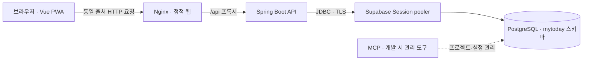

# MY TODAY 개발 상세 문서

작성 기준: 2026-11-10. 이 문서는 저장소에 실제 구현된 코드와 설정을 설명한다. 앞으로 만들 기능을 담은 [제품 명세](MASTER_SPEC.md)와 구분하며, 버전은 최신 권장 버전이 아니라 현재 프로젝트에 선언된 값이다.

## 1. 어떤 서비스인가

MY TODAY는 오늘의 일정·할 일, 실제 활동과 성장, 가계부, 투자 기록을 하나의 계정에서 관리하는 반응형 웹/PWA다. 일반 사용자는 초대 코드로 가입하고 최초 설정을 마친 뒤 개인 홈을 사용한다. 게스트는 가입 없이 24시간 동안 독립된 개인 공간을 체험한다. 관리자는 회원과 가입 초대를 확인한다.

개발은 인증·배포 기반 → 할 일·일정 → 관리자 권한 → 성장·가계부·투자 → 게스트 체험 → 첫 가입 축하·사용 가이드 순서로 확장했다. 단계마다 기존 사용자 데이터를 유지하는 Flyway 마이그레이션을 추가하고, API와 화면을 연결한 뒤 테스트했다.

## 2. 기술 스택

### 프런트엔드

| 기술 | 프로젝트 버전 | 사용 목적 |
|---|---|---|
| Node.js | 24 계열, Docker·CI 24.22.2 | 개발 도구와 웹 빌드 실행 |
| Vue | 3.5.44 | Composition API와 단일 파일 컴포넌트로 화면 구현 |
| TypeScript | 6.0.3 | API 응답·화면 상태 타입 검사 |
| Quasar | 2.35.2 | 버튼·입력·선택·체크박스·대화상자·로딩 UI |
| Vue Router | 5.4.0 | 로그인·권한·최초 설정에 따른 화면 이동 |
| Pinia | 4.1.0 | 현재 로그인 세션과 연결 상태 관리 |
| Vite | 8.3.5 | 개발 서버, API 프록시, 배포 파일 생성 |
| Sass | 1.107.1 | 공통 색상·레이아웃·반응형·축하 애니메이션 |
| vite-plugin-pwa | 2.0.0 | manifest와 서비스워커 생성 |
| Vitest | 5.0.5 | 세션·안전한 이동·날짜 처리 등의 단위 테스트 |
| Playwright | 1.64.1 | 실제 브라우저에서 사용자 흐름과 모바일 폭 검증 |
| ESLint / vue-tsc | 9 계열 / 3.3.14 | 코드 규칙과 Vue·TypeScript 정적 검사 |

정확한 선언과 고정된 의존성은 [package.json](../apps/web/package.json), [package-lock.json](../apps/web/package-lock.json)에 있다. `npm ci`로 잠금 파일에 맞춰 설치한다.

### 백엔드·데이터·실행 환경

| 기술 | 프로젝트 버전·설정 | 사용 목적 |
|---|---|---|
| Java | 21 | API 런타임 |
| Spring Boot | 4.1.2 | REST API, 설정, 트랜잭션, 상태 확인 |
| Spring MVC | Boot 의존성 관리 | HTTP 요청과 JSON 응답 |
| Spring Security | Boot 의존성 관리 | 서버 세션·CSRF·접근 권한·BCrypt |
| Spring JDBC / JdbcClient | Boot 의존성 관리 | SQL을 직접 작성해 데이터 조회·변경 |
| Bean Validation | Boot 의존성 관리 | 입력값 검증 |
| PostgreSQL | 로컬 이미지 17.6-alpine | 사용자·계획·성장·금융 데이터 저장 |
| Supabase PostgreSQL | 연결 기록 기준 17.11, 서울 리전 | 현재 실행 앱의 외부 DB |
| Flyway | Boot 의존성 관리 | V1–V7 스키마 변경과 이력 관리 |
| HikariCP | Boot 기본 풀, 외부 DB 최대 5개 연결 | JDBC 연결 재사용 |
| springdoc-openapi | 3.0.3 | 개발용 OpenAPI·Swagger UI |
| Gradle Wrapper | 9.8.2 | API 의존성·테스트·JAR 빌드 |
| Testcontainers / JUnit | Boot 의존성 관리 | 격리된 실제 PostgreSQL 기반 통합 테스트 |
| Docker Compose | v2.24.4 이상 | DB·API·웹의 실행·상태 확인 |
| Nginx | 1.28.0-alpine | 정적 웹 제공과 API 역방향 프록시 |
| Caddy | 2.10.2-alpine | 운영 구성의 HTTPS 진입점 |
| GitHub Actions | 저장소 workflow | 웹·API 검사 자동화 |

백엔드 버전의 근거는 [build.gradle](../services/api/build.gradle), [Gradle Wrapper](../services/api/gradle/wrapper/gradle-wrapper.properties)다. 개별 Spring·JDBC·Flyway 라이브러리는 Spring Boot가 관리하므로 별도 버전을 임의로 적지 않았다.

## 3. 전체 구조와 데이터 흐름



현재 로컬 접속 주소는 `http://localhost:8088`이다. 브라우저는 Nginx를 통해 웹 파일과 `/api/v1` API를 같은 출처에서 사용한다. 사용자 데이터는 API가 세션·입력·소유권을 검증한 뒤 SQL로 저장한다.

Supabase는 DB로 사용한다. 사용자 로그인은 Spring Security가 처리하고, 브라우저의 Supabase SDK나 Supabase Auth는 사용하지 않는다. MCP는 개발 중 프로젝트·스키마·설정을 확인하는 관리 도구이며, 앱이 실행될 때의 DB 연결은 JDBC가 담당한다.

현재 공개 도메인에 배포된 상태는 아니다. Vercel 배포도 적용되지 않았다. 저장소에는 Caddy HTTPS 운영 구성이 준비되어 있지만 실제 도메인·TLS 운영 검증은 후속 작업이다.

### 코드 구조

```text
apps/web/
  src/api/            HTTP 공통 처리, 도메인별 응답 타입
  src/stores/         로그인 세션 상태
  src/composables/    개인 데이터 조회·변경·오류 처리
  src/pages/          공개·홈·계획·성장·가계부·투자·관리자 화면
  src/components/     할 일·일정 편집기, 축하·사용 가이드
  src/styles/         공통 디자인과 반응형 스타일
  tests/e2e/          인증·권한·도메인·게스트·가이드 브라우저 테스트
services/api/
  src/main/java/com/mytoday/
    identity/         가입·로그인·권한·게스트·관리자
    planning/         할 일·일정·오늘 집계
    growth/           실제 활동·목표·루틴·회고
    money/            계좌·거래·분개·예산
    invest/           관심종목·수동 가격·매매·손익
  src/main/resources/db/migration/   V1–V7 SQL
  src/test/                         PostgreSQL 통합 테스트
infra/               Docker Compose·Nginx·Caddy·공개 CA 인증서
scripts/             로컬 시작·종료 스크립트
docs/                명세·구현·API·보안·운영·검증 기록
```

백엔드는 도메인 패키지별 Controller가 요청 검증·업무 로직·`JdbcClient` SQL을 처리하는 구조다. 별도의 JPA Entity·Repository·Service 계층을 도입하지 않았다. JSON 입출력은 Java record를 사용하고, 여러 SQL을 묶어야 하는 변경에는 `@Transactional`을 적용한다.

## 4. 프런트엔드 구현 방식

### 화면 이동과 로그인 상태

[router.ts](../apps/web/src/router.ts)가 공개 화면과 보호 화면을 구분한다. 공개 화면은 환영·로그인·가입·개인정보 안내이고, 보호 화면은 오늘·일정·할 일·성장·가계부·투자·설정·관리자다.

[session.ts](../apps/web/src/stores/session.ts)는 `/auth/session` 결과를 보관한다. 401은 비로그인으로 처리하고, 네트워크 장애나 서버 오류는 연결 상태를 확인할 수 없는 상황으로 구분해 재시도를 보여준다. 보호 화면 이동 시 서버에서 세션을 다시 확인한다.

최초 설정이 끝나지 않으면 `/onboarding`으로 이동한다. 설정 완료 후 기본 목적지는 USER `/today`, ADMIN `/admin`이다. 로그인 이전에 가려던 내부 경로는 [navigation.ts](../apps/web/src/navigation.ts)의 허용 목록을 통과한 경우 보존한다. 외부 URL이나 USER의 관리자 경로는 목적지로 허용하지 않는다.

### API 호출과 오류 처리

[client.ts](../apps/web/src/api/client.ts)의 `api()`가 `/api/v1` 경로와 JSON·세션 쿠키를 공통 처리한다. GET·HEAD 외 요청은 먼저 `/auth/csrf`에서 토큰과 헤더명을 받아 변경 요청에 붙인다. 응답 실패는 HTTP 상태와 메시지를 가진 `ApiError`로 전달한다.

[usePersonalData.ts](../apps/web/src/composables/usePersonalData.ts)는 성장·가계부·투자의 조회·저장 중 상태·성공 안내·재시도·세션 만료를 공통 처리한다. 늦게 도착한 이전 조회 결과가 현재 화면을 덮어쓰지 않도록 요청 순서를 비교한다. 401이면 개인 데이터를 비우고 로그인으로 이동한다. 충돌 시 최신 데이터를 다시 읽고 화면의 입력 상태와 오류를 통해 사용자가 해결하게 한다.

할 일·일정은 홈·목록에서 [TaskEditor.vue](../apps/web/src/components/TaskEditor.vue), [EventEditor.vue](../apps/web/src/components/EventEditor.vue)를 재사용한다. 삭제 전 확인하고, 오래된 버전으로 저장이 거부되면 작성 중인 초안을 보존한다.

### 금액·날짜·모바일

금액은 십진수 문자열로 받고 [decimal.ts](../apps/web/src/decimal.ts)에서 문자열 기반으로 천 단위 구분과 소수점 표시를 처리한다. JavaScript `Number` 변환으로 큰 금액이나 소수 정밀도가 달라지는 것을 피한다.

달력 날짜와 절대 시각을 구분한다. 사용자 시간대로 오늘을 계산하고, 일정 입력에는 일정의 원래 시간대를 사용한다. [planningDates.ts](../apps/web/src/planningDates.ts)는 날짜 이동과 시간대 변환을 처리하며 DST로 존재하지 않는 시각 등도 검증한다.

360px부터 지원하고, 1024px 이상은 사이드바를 사용한다. 모바일은 하단 메뉴와 상단 보조 메뉴를 사용한다. 디자인 기준은 [DESIGN.md](../DESIGN.md), 실제 스타일은 [app.scss](../apps/web/src/styles/app.scss)에 있다.

## 5. 가입·로그인·관리자·게스트

### 일반 가입과 로그인

1. 초대 코드·이메일·표시 이름·비밀번호·비밀번호 확인을 서버로 보낸다.
2. 서버가 초대 코드와 입력을 검증하고 BCrypt 비용 12로 비밀번호를 해시한다. 비밀번호는 12자 이상, UTF-8 기준 72바이트 이하로 제한한다.
3. 가입 계정의 역할은 서버가 USER로 정한다. 클라이언트가 ADMIN을 보내도 승격되지 않는다.
4. 로그인 성공 시 서버 세션에 인증 정보를 저장하고 `MT_SESSION` 쿠키로 연결한다.
5. 최초 프로필 설정을 저장하면 `onboardingCompleted`가 완료되어 개인 홈으로 이동한다.

쿠키는 HttpOnly·SameSite=Lax이며 운영 프로필에서는 Secure를 강제한다. 세션 비활동 제한은 7일, 인증 시각 기준 최대 기간은 30일이다. 로그인 시 세션 ID를 변경하고 CSRF 토큰을 갱신한다. 로그인 실패·게스트 생성에는 서버 메모리 기반 속도 제한이 적용된다.

### 관리자와 개인 데이터 격리

관리자 API는 세션에 남은 역할만 믿지 않고 매 요청 현재 DB의 ADMIN 여부를 확인한다. 관리자도 타인의 할 일·성장·금융 기록을 조회하지 못한다. 개인 API는 세션의 사용자 ID를 SQL 조건에 넣으며 다른 사람의 기록 ID를 지정하면 404를 반환한다.

관리자 화면은 회원의 이메일·이름·역할·가입 시각·최초 설정 여부와 가입 초대를 보여준다. 비밀번호·해시·타인의 개인 기록은 응답에 포함하지 않는다. 초대 코드는 화면에서 기본 마스킹한다.

최초 관리자는 [AdminBootstrap.java](../services/api/src/main/java/com/mytoday/identity/AdminBootstrap.java)와 별도 Compose 구성으로 만든다. DB advisory lock으로 동시 초기화를 직렬화하며 기존 USER의 자동 승격이나 기존 관리자 비밀번호 덮어쓰기는 허용하지 않는다. 실제 비밀번호는 Git 제외 파일에 보관하며 문서에는 기록하지 않는다.

### 게스트 체험

`POST /api/v1/auth/guest`는 독립 USER 계정을 만들고 만료 시각을 24시간 뒤로 설정한다. 게스트는 온보딩 없이 오늘 화면으로 진입하며 일반 계정과 동일한 세션·CSRF·개인 데이터 격리를 적용받는다.

만료 시각이 지나면 모든 개인 API 접근을 401로 차단한다. [GuestCleanup.java](../services/api/src/main/java/com/mytoday/identity/GuestCleanup.java)가 매시간 만료 계정과 종속 기록을 정리한다. 게스트 데이터를 일반 가입 계정으로 이전하는 기능은 없다.

## 6. 기능별로 어떻게 개발했는가

### 오늘·할 일·일정

[PlanningController.java](../services/api/src/main/java/com/mytoday/planning/PlanningController.java)는 할 일·일정 CRUD와 오늘 집계를 제공한다. 할 일은 날짜 마감·시각 마감·마감 없음, 상태·우선순위·예상 시간을 지원한다. 완료·완료 취소는 별도 API이며 활동 시간을 자동으로 만들지 않는다.

일정은 종일과 시간 지정을 나눈다. 종일은 시작일 포함·종료일 제외로 저장한다. 예를 들어 11월 10일 하루 일정은 시작 `2026-11-10`, 제외 종료 `2026-11-11`이다. 시간 일정은 절대 시각과 원래 시간대를 함께 보관한다. 월·주·일 화면에서는 조회 범위에 겹치는 일정을 읽는다.

수정·삭제는 `version`을 비교한다. 예를 들어 A 기기가 version 0을 읽은 뒤 B 기기가 수정하여 version 1이 되었다면, A의 version 0 저장은 409로 거부한다. 삭제는 소프트 삭제로 이력을 남긴다. 오늘 집계는 사용자 시간대의 자정부터 다음 자정까지 계산하며 목록은 최대 100건, 전체 개수는 별도로 집계한다.

### 성장

[GrowthController.java](../services/api/src/main/java/com/mytoday/growth/GrowthController.java)는 실제 활동, 분야별 기간 목표, 요일 루틴, 하루 회고를 처리한다.

활동에 날짜·분야·실제 분·수량·단위·메모를 기록한다. 목표 진척도는 같은 분야와 목표 기간에 속하는 삭제되지 않은 실제 활동의 분 합계로 계산한다. 활동을 수정·삭제하면 집계도 변경된다.

루틴은 요일별 정의와 개별 날짜의 수행 상태를 나눈다. 조회한 날짜에 필요한 수행 항목을 중복 없이 생성하고 목표 시간을 스냅샷으로 남긴다. 루틴 수정 시 과거 정의와 이미 만들어진 과거·현재 항목을 보존하고 미래 항목에 새 정의를 적용한다. 루틴 체크는 실제 활동 시간을 생성하지 않는다. 회고는 잘한 점·아쉬운 점·다음 행동을 날짜별로 저장한다.

### 가계부

[MoneyController.java](../services/api/src/main/java/com/mytoday/money/MoneyController.java)는 계좌·수입·지출·동일 통화 이체·월 예산을 처리한다. 계좌 잔액은 시작 잔액과 해당 계좌의 분개 합계로 구한다. 부채 계좌의 시작 잔액은 0 이하, 자산은 0 이상이다.

각 거래는 통화별 합계가 0인 분개를 하나의 트랜잭션으로 기록한다. 수입·지출은 가상 상대 분개를 두고, 이체는 실제 두 계좌에 반대 금액을 남긴다. 예를 들어 A에서 B로 10,000 KRW를 이체하면 A -10,000, B +10,000이며 월 지출에는 포함하지 않는다.

저장에는 클라이언트 UUID인 `requestId`를 보낸다. 같은 ID와 같은 내용의 재시도는 기존 거래를 반환하고, 같은 ID로 다른 내용을 보내면 409다. 취소는 원거래를 VOID로 표시하고 반대 분개를 가진 REVERSAL 거래를 추가한다. 원거래와 취소 기록은 보존한다. 오류 수정은 전체 취소 후 새 거래를 기록하는 방식이며 부분 환불은 지원하지 않는다.

월 예산은 월·분야·통화별로 저장하고 실제 지출과 잔여 예산을 계산한다. KRW·USD·JPY는 서로 더하지 않는다. 월 거래 목록은 최신 200건까지 보여주지만 합계와 예산 집계는 전체 기록을 사용한다.

### 투자

[InvestmentController.java](../services/api/src/main/java/com/mytoday/invest/InvestmentController.java)는 거래소·종목코드별 관심종목, 기준시각이 있는 수동 가격, 매수·매도·최근 거래 취소를 처리한다.

보유 수량과 원가는 거래를 순서대로 재계산하는 이동평균 방식이다. 매수 원가는 `수량 × 가격 + 수수료 + 세금`이고, 매도 실현손익은 `매도 대금 - 수수료 - 세금 - 배분한 평균 원가`다. 예를 들어 수수료 없이 10주를 100에, 10주를 120에 매수하면 평균 원가는 110이다. 5주를 130에 매도한 실현손익은 100, 잔여 수량은 15주, 잔여 원가는 1,650이다.

서버는 BigDecimal과 내부 소수 12자리·HALF_EVEN 반올림을 사용한다. 전량 매도 시 남은 원가를 모두 제거한다. 보유 수량을 넘는 매도와 이전 거래보다 과거인 거래 추가는 거부한다. 수정은 해당 종목의 가장 최근 유효 거래를 취소한 뒤 새 거래로 기록한다.

사용자별 잠금으로 동시 저장과 중복·초과 매도를 방지하고 `requestId`로 재시도를 처리한다. 가격이 없는 보유 종목은 평가액을 0으로 만들지 않고 미제공으로 표시한다. 투자 기록은 가계부 현금 원장과 연동되지 않는다.

### 첫 가입 축하와 사용 가이드

[PublicPage.vue](../apps/web/src/pages/PublicPage.vue)는 일반 USER가 최초 설정을 성공적으로 저장했을 때 현재 사용자 ID를 `sessionStorage`의 `mytoday-first-welcome`에 기록한다. [HomePage.vue](../apps/web/src/pages/HomePage.vue)는 진입 시 이 값을 현재 사용자와 비교하고 즉시 제거한 뒤 축하 화면을 연다. 이후 새로고침·재로그인에는 반복 표시하지 않는다. 게스트와 ADMIN의 최초 설정에서는 이 표시를 만들지 않는다.

[WelcomeGuide.vue](../apps/web/src/components/WelcomeGuide.vue)는 축하 화면과 6개 메뉴 설명을 제공한다. CSS 색종이 18개와 별 배지 애니메이션을 사용하며, 건너뛰기·이전·다음·시작하기를 제공한다. 데스크톱 사이드바와 모바일 보조 메뉴의 사용 가이드 버튼은 축하 화면 없이 설명부터 연다. `prefers-reduced-motion`에서는 장식 애니메이션을 끈다.

이 기능의 표시 상태는 서버의 별도 열에 저장하지 않는다. 현재 탭에서 최초 설정 후 이동하는 흐름을 위한 일회성 표시이며, 브라우저가 sessionStorage를 차단하면 자동 축하를 생략한다. 수동 가이드는 계속 사용할 수 있다.

## 7. DB 설계와 마이그레이션

| 마이그레이션 | 테이블·주요 변경 |
|---|---|
| V1 identity | `app_user`: 계정·비밀번호 해시·프로필·최초 설정 |
| V2 planning | `task`, `calendar_event`: 할 일·일정, 버전·소프트 삭제 |
| V3 user_roles | `app_user.role`: ADMIN/USER, 기존 계정 USER 유지 |
| V4 growth | `activity_log`, `growth_goal`, `growth_routine`, `growth_routine_revision`, `growth_routine_occurrence`, `growth_reflection` |
| V5 money | `money_account`, `money_transaction`, `money_posting`, `money_budget` |
| V6 investments | `investment_instrument`, `investment_trade` |
| V7 guest | `app_user.guest_expires_at`와 만료 검색용 인덱스 |

총 15개 앱 테이블과 Flyway 관리 이력이 있다. 사용자 ID는 UUID이고 개인 데이터에는 소유 사용자 ID를 둔다. 금융의 복합 외래 키는 다른 사용자 계좌·종목을 연결하는 오류도 차단한다. 거래 재시도 키·관심종목·월 예산 등에는 업무별 UNIQUE 제약을 두고, 통화·상태·양수 금액 등은 CHECK 제약으로 제한한다.

가계부·투자의 입력 금액과 수량은 PostgreSQL `NUMERIC(20,6)`으로 저장한다. 날짜는 DATE, 절대 시각은 TIMESTAMPTZ로 구분한다. 애플리케이션 검증과 DB 제약을 함께 사용한다. 성장·계획 등 버전이 있는 데이터는 낙관적 동시성 검사로 덮어쓰기를 막고, 금융 거래는 트랜잭션과 사용자별 잠금을 사용한다.

마이그레이션 파일은 [db/migration](../services/api/src/main/resources/db/migration)에 있다. API 시작 시 Flyway가 이력을 검사하고 새 버전만 적용한다. 기존 적용 SQL을 다시 고치기보다 다음 버전의 변경 파일을 추가하는 방식으로 확장한다.

## 8. Supabase·보안·PWA 운영

외부 DB 구성은 [compose.supabase.yml](../infra/compose.supabase.yml)로 분리했다. `mytoday` 스키마와 전용 앱 계정을 사용하고 Session pooler 5432로 접속한다. `sslmode=verify-full`과 공개 CA 인증서 마운트로 서버 인증서·호스트를 검증한다. DB 연결 풀 크기는 최대 5다.

DB 비밀번호·초대 코드·관리자 초기 비밀번호는 Git 제외 환경 파일에서 읽는다. 프런트엔드 `VITE_*` 값이나 브라우저 코드에 넣지 않는다. 앱 스키마는 Supabase 익명·일반 Data API 사용자에게 공개하지 않으며 개인 데이터 접근은 Spring API를 거친다. 상세 설정은 [CLOUD_DATABASE.md](CLOUD_DATABASE.md), [SECURITY.md](SECURITY.md), [ACCESS_CONTROL.md](ACCESS_CONTROL.md)를 따른다.

PWA는 JS·CSS·HTML·아이콘 같은 정적 자산만 사전 캐시한다. `/api`는 SPA 오프라인 fallback 대상에서 제외하고 API 응답에는 `no-store`를 적용한다. 개인 기록의 오프라인 편집이나 동기화는 구현하지 않았다. manifest와 아이콘은 준비되어 있으나 실기기 설치·HTTPS 환경 검증은 별도다.

Nginx가 `/api`를 API로 전달하고 화면 직접 접근은 `index.html`로 연결한다. 운영용 Caddy 구성에서는 HTTPS와 신뢰한 프록시 주소를 사용한다. API에는 `X-Request-ID`를 부여하고 로그 MDC에도 넣어 요청별 오류를 추적할 수 있다. 상태 확인은 API `/actuator/health`, 웹 `/healthz`다.

## 9. 실행과 개발 방법

### 기본 로컬 DB로 실행

Docker·Compose를 설치하고 새 환경에서만 `.env.example`을 `.env`로 복사한다. DB 관리자 비밀번호·앱 DB 비밀번호·가입 초대 코드를 설정한다. 기존 환경 파일을 예시로 덮어쓰지 않는다.

```bash
cp .env.example .env
./scripts/dev-up.sh
```

웹은 `http://localhost:8088`이다. `./scripts/dev-down.sh`로 종료해도 DB 볼륨은 유지된다.

### 현재 Supabase 구성으로 실행

검증된 `.env`·`.env.supabase`와 CA 파일이 준비된 환경에서 저장소 루트에서 실행한다.

```bash
docker compose --env-file .env --env-file .env.supabase \
  -f infra/compose.local.yml -f infra/compose.supabase.yml \
  up -d --build --wait api web
```

외부 설정에는 `EXTERNAL_DB_URL`, `EXTERNAL_DB_USERNAME`, `EXTERNAL_DB_PASSWORD`가 필요하다. 원본 로컬 DB 데이터가 Supabase에 자동 복사되는 구성은 아니다.

### 프런트엔드 개발·검사

```bash
cd apps/web
npm ci
npm run lint
npm run typecheck
npm test
npm run build
API_PROXY_TARGET=http://localhost:8088 npm run dev
```

Vite 기본 포트는 5173이고 기본 API 대상은 `localhost:8080`이다. 위 명령은 현재 Compose의 Nginx를 API 프록시 대상으로 사용한다.

### API 검사·빌드

Java 21·Docker를 준비한다. 테스트는 실제 서비스 DB 대신 Testcontainers PostgreSQL을 사용한다.

```bash
cd services/api
./gradlew test bootJar
```

개발 OpenAPI는 API 내부 `/v3/api-docs`, Swagger UI는 `/swagger-ui/index.html`이다. 현재 Nginx는 이 경로를 외부 API 문서로 전달하지 않는다. API별 요청·응답은 [API.md](API.md), [GROWTH_API.md](GROWTH_API.md), [MONEY_API.md](MONEY_API.md), [INVEST_API.md](INVEST_API.md)를 참고한다.

## 10. 어떻게 검증했는가

백엔드 통합 테스트는 실제 PostgreSQL에서 회원가입·CSRF·세션·타인 데이터 격리·관리자 권한·게스트 만료·날짜 경계·수정 충돌·목표 재집계·금융 취소·중복 요청·투자 손익 등을 확인한다. 브라우저 mock 테스트는 API 응답을 통제하여 사용자 동작과 오류·재시도·모바일 레이아웃을 검사한다. 실제 API 브라우저 테스트는 별도 개발 환경과 명시적 초대 코드가 있어야 실행된다.

```bash
cd apps/web
npx playwright install chromium
npm run test:e2e
# 설치된 Chrome으로 실행할 경우
E2E_BROWSER_CHANNEL=chrome npm run test:e2e
```

`E2E_BASE_URL`로 이미 실행 중인 웹을 지정할 수 있다. 지정하지 않으면 테스트가 5187 포트에 개발 서버를 띄운다. 실제 API 테스트에는 `E2E_INVITE_TOKEN` 등이 필요하며 계정과 기록을 생성하므로 격리한 개발 DB를 사용한다.

2026-11-10 기능 개발 당시 기록은 웹 단위 테스트 10개, Chrome 시나리오 34개 통과·실제 API용 6개 건너뛰기, 타입 검사·린트·PWA 빌드 통과다. API 전체 30개 통합 테스트 통과 기록도 있다. 이는 기능 개발 시점의 결과이며 이 문서 작성 중 테스트를 새로 실행했다는 의미는 아니다. 자세한 결과와 미검증 항목은 [VALIDATION.md](VALIDATION.md)에 보존한다.

GitHub Actions는 API의 `test bootJar`, 웹의 린트·타입 검사·단위 테스트·빌드를 수행하도록 설정했다. Playwright E2E는 현재 workflow의 자동 실행 단계에 포함하지 않는다.

## 11. 남아 있는 범위

공개 가입, 이메일 인증·비밀번호 복구, 외부 캘린더·반복 일정, 은행 자동 연동·OCR, 자동 시세·실제 주문은 미구현이다. 오늘 홈의 성장·금융 요약은 아직 해당 기록의 실시간 합계와 연결하지 않았다. 투자와 가계부 현금도 독립되어 있다.

세션·속도 제한은 API 프로세스 메모리에 있으므로 API 재시작 시 로그인 상태가 초기화된다. 여러 API 인스턴스로 확장하려면 공유 세션·속도 제한 저장소를 추가해야 한다. 현재 공개 서버 배포·실제 HTTPS·iPhone Safari/Android 설치·복구 절차의 운영 검증은 완료하지 않았다. 가계부·투자의 목록 수 제한과 수동 입력 정책은 각 API 문서에 명시되어 있다.
